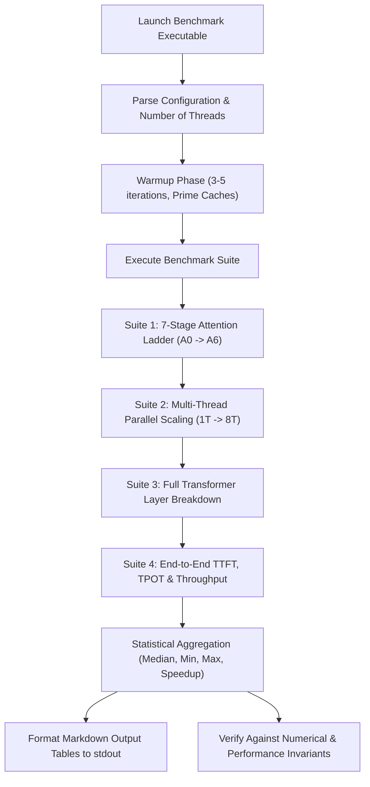

# Hệ Thống Đối Chuẩn & Phân Tích Thực Nghiệm Hiệu Năng (Tersun Benchmark & Forensics Reference)

```text
Document Version:    1.1.0
Architecture State:  Tersun Gate 7.5 (Cryptographically Sealed)
Subsystem:           Decoupled Performance Harness, Forensic Instrumentation & LLM Metrics
Primary Owners:      Performance Engineering & Quality Assurance Team
```

---

## I. Vai Trò & Trách Nhiệm Hệ Thống Con (File Đó Làm Gì)

Thư mục `Code/benchmarks/` chứa toàn bộ hạ tầng đo lường định lượng, đối chuẩn hiệu năng đa tầng và phân tích vi phẫu mã máy (Forensics) của dự án Tersun:
1. **Đối chuẩn thực thi mô hình LLM (`bench_llm_execution.cpp` - Gate 7.5)**: Đo đạc độc lập tốc độ của Thang Attention 7 bậc ($A_0 \to A_6$), hiệu suất mở rộng luồng OpenMP (1T, 2T, 4T, 8T), phân rã chi phí thành phần trong một lớp Transformer, và các chỉ số suy luận tiêu chuẩn: TTFT, TPOT (cold/warm), throughput tokens/giây.
2. **Đối chuẩn thực thi đa tầng 4 tải kinh điển W1–W4 (`bench_4tier_execution.cpp`)**: So sánh thời gian chạy của Tier-0 (Interpreter), Tier-1 (Baseline JIT), Tier-2 (Optimizing JIT AVX2) và Native AOT `-O3` đối chiếu trực tiếp với C++ GCC 15.2, Rust 1.98, Java 25 và Python 3.14.
3. **Đo đạc hình phạt trừu tượng (`bench_abstraction_penalty.cpp`, `bench_gemv_abstraction_penalty.cpp`)**: Phân tích chi phí gián tiếp khi gọi toán tử qua các lớp trừu tượng `TensorView` so với con trỏ thô C++.
4. **Báo cáo vi phẫu mã máy (`forensics/`, `g6r2/`)**: Lưu trữ phân tích assembly, loại bỏ kiểm tra biên (BCE Hoisting), vector hóa SIMD, và phân tích độ trôi bộ nhớ qua hàng triệu vòng lặp.

---

## II. Nguyên Lý & Cơ Chế Hoạt Động (Như Thế Nào)

### 1. Nguyên Tắc Đo Đạc Phân Tách (Decoupled Benchmarking)
Để tránh hiện tượng tối ưu hóa lồng nhau làm lu mờ kết quả của từng kỹ thuật riêng lẻ:
- Đo lường riêng biệt hiệu quả của **Thuật toán Online Softmax** ($A_0 \to A_1$).
- Đo lường riêng biệt hiệu quả của **Vector hóa SIMD FMA** ($A_1 \to A_4$).
- Đo lường riêng biệt hiệu quả của **Phân khối 2D Cache Tiling** ($A_4 \to A_5$).
- Đo lường riêng biệt hiệu quả của **Song song hóa GQA đa luồng** ($A_5 \to A_6$).

### 2. Phương Pháp Khử Nhiễu Thực Nghiệm (Noise Reduction Methodology)
- **Chu kỳ làm nóng (Warmup Iterations)**: Chạy tối thiểu 3 đến 5 lượt khởi động để đưa dữ liệu vào bộ nhớ đệm L1/L2 và ổn định xung nhịp CPU trước khi bấm giờ.
- **Tính toán trung vị (Median of N Runs)**: Đo đạc $N \ge 10$ lượt lặp độc lập và lấy giá trị trung vị để loại bỏ nhiễu do hệ điều hành ngắt (OS Jitter).
- **Bộ đếm thời gian độ phân giải cao**: Sử dụng `std::chrono::high_resolution_clock` kết hợp với thanh ghi chu kỳ xung nhịp phần cứng vi xử lý `RDTSC` có rào cản `lfence`.

---

## III. Cấu Trúc Dữ Liệu & Danh Mục Tệp Nguồn (Cấu Trúc Ra Sao)

### 1. Danh Mục Tệp Nguồn Benchmark
- `Code/benchmarks/bench_llm_execution.cpp`: Target `gate75_benchmark` trong CMake. Cung cấp 4 bài kiểm tra vi kiến trúc:
  1. `run_ladder_benchmark`: Đo thang $A_0 \to A_6$ trên $S \in \{64, 256, 512, 1024\}$.
  2. `run_parallel_scaling_benchmark`: Đo độ co giãn 1T, 2T, 4T, 8T.
  3. `run_layer_breakdown_benchmark`: Phân rã thời gian Attention, QKV, Output, FFN SwiGLU, RMSNorm.
  4. `run_ttft_tpot_benchmark`: Đo TTFT, TPOT cold, TPOT warm và Throughput tok/s.
- `Code/benchmarks/bench_4tier_execution.cpp`: Đo 4 bài toán kinh điển: W1 (Fibonacci đệ quy), W2 (Sàng nguyên tố Eratosthenes), W3 (Nhân ma trận phẳng), W4 (Cập nhật 200k đối tượng struct).
- `Code/benchmarks/bench_gemv_abstraction_penalty.cpp`: Đo đạc độ suy hao khi gọi GEMV qua abstraction.
- `Code/benchmarks/forensics/reports/`: Các báo cáo phân tích sâu W1.md, W2.md, W3.md, W4.md.
- `Code/benchmarks/g6r2/reports/`: Báo cáo phân tích loại bỏ kiểm tra biên (BCE) và vector hóa AVX2.

---

## IV. Sơ Đồ Quy Trình Thực Thi Benchmark (Pipeline Rõ Ràng)



### Lệnh Thực Thi & Kiểm Tra
```bash
# Chạy toàn bộ benchmark LLM Gate 7.5:
cd build
.\benchmarks\gate75_benchmark.exe

# Chạy benchmark thực thi 4 tầng:
.\benchmarks\bench_4tier_execution.exe
```
