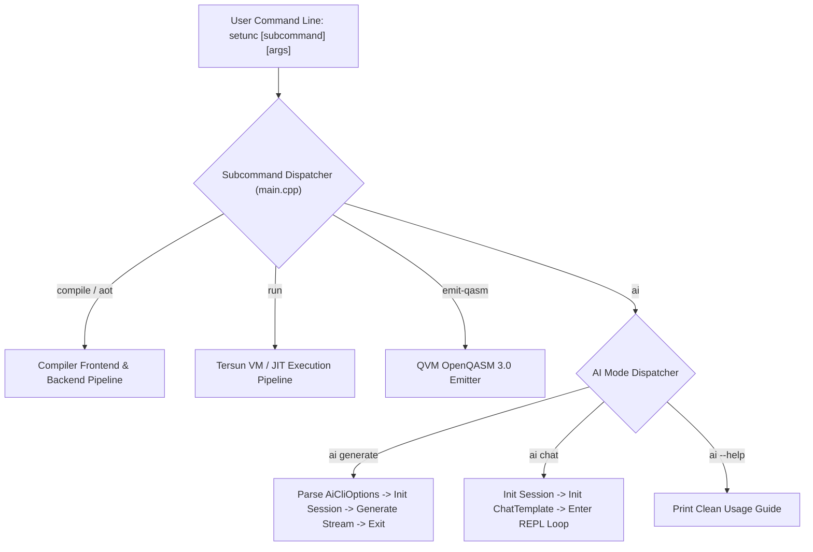

# Kiến Trúc Giao Diện Dòng Lệnh & Tích Hợp AI CLI (Tersun CLI Architecture Reference)

```text
Document Version:    1.1.0
Architecture State:  Tersun Gate 7.5 (Cryptographically Sealed)
Subsystem:           Command-Line Interface, AI Options Parser & REPL Runners
Primary Owners:      Developer Toolchain & CLI Experience Team
```

---

## I. Vai Trò & Trách Nhiệm Hệ Thống Con (File Đó Làm Gì)

Thư mục `Code/src/cli/` và `Code/include/cli/` cung cấp bộ giao diện dòng lệnh hợp nhất cho công cụ biên dịch `setunc` và công cụ chạy mô hình trí tuệ nhân tạo `tersun_ai_runner`:
1. **Phân tích cú pháp cờ lệnh AI (`ai_options.hpp/cpp`)**: Trích xuất và xác thực toàn bộ các tham số cấu hình suy luận LLM từ console (đường dẫn gói mô hình, prompt, tham số lấy mẫu temperature, top-k, top-p, penalties, v.v.).
2. **Thực thi lệnh AI độc lập (`ai_runner_main.cpp`)**: Cung cấp điểm vào độc lập cho binary chuyên biệt `tersun_ai_runner.exe` khi triển khai suy luận không cần toàn bộ compiler frontend.
3. **Điều phối các chế độ hoạt động (Subcommands)**:
   - `compile`: Biên dịch mã nguồn Setun sang Bytecode (`.tbc`).
   - `run`: Thực thi trực tiếp trên máy ảo VM đa tầng với các cờ `--jit`, `--jit-osr`.
   - `aot`: Biên dịch tĩnh Native AOT `-O3` thành file thực thi nhị phân.
   - `emit-qasm`: Xuất mạch lượng tử sang định dạng chuẩn OpenQASM 3.0.
   - `ai generate`: Thực hiện sinh văn bản một lần từ prompt.
   - `ai chat`: Khởi chạy phiên hội thoại tương tác REPL đa lượt với mô hình.

---

## II. Nguyên Lý & Cơ Chế Hoạt Động (Như Thế Nào)

### 1. Phân Tích Cú Pháp Tùy Chọn AI (`AiCliOptions`)
Cấu trúc [`AiCliOptions`](file:///d:/New%20PJ/Ternary/Compiler/Code/include/cli/ai_options.hpp) quản lý các tham số dòng lệnh và thực hiện xác thực biên:
- `model_dir`: Đường dẫn đến thư mục chứa `config.json`, `tokenizer.json` và `model.safetensors`.
- `prompt`: Chuỗi truy vấn đầu vào cho chế độ `generate`.
- `temperature`: Nhiệt độ lấy mẫu $T \in [0.0, 2.0]$. Khi $T = 0 \implies$ kích hoạt Greedy Argmax.
- `top_k`: Giới hạn lấy mẫu trong top $K$ tokens có xác suất cao nhất.
- `top_p`: Ngưỡng xác suất tích lũy Nucleus Sampling $P \in (0.0, 1.0]$.
- `repetition_penalty`: Hệ số phạt lặp $\alpha \ge 1.0$.
- `max_tokens`: Giới hạn số lượng token tối đa được phép sinh.
- `threads`: Số lượng luồng OpenMP được cấp cho `ParallelPlanner`.

### 2. Vòng Lặp Tương Tác REPL Chat (`ai chat`)
Khi người dùng kích hoạt `ai chat`:
1. Khởi tạo một phiên [`InferenceSession`](file:///d:/New%20PJ/Ternary/Compiler/Code/include/tensor/nn/runtime/inference_session.hpp) và nạp trọng số mô hình.
2. Thiết lập cấu trúc [`ChatTemplate`](file:///d:/New%20PJ/Ternary/Compiler/Code/include/tensor/nn/format/chat_template.hpp) theo chuẩn ChatML.
3. Vào vòng lặp tương tác:
   - Đọc câu hỏi từ `std::cin`.
   - Ghép nối tin nhắn người dùng vào khuôn mẫu ChatML.
   - Chạy hàm `generate_stream()` với callback in trực tiếp từng token ra console (`std::cout << token << std::flush;`).
   - Cập nhật câu trả lời của trợ lý vào lịch sử hội thoại, duy trì trạng thái ngữ cảnh trong `KVCache`.

---

## III. Cấu Trúc Dữ Liệu & Danh Mục Tệp Nguồn (Cấu Trúc Ra Sao)

### 1. Danh Mục Tệp Nguồn
- `Code/include/cli/ai_options.hpp`: Định nghĩa `enum class AiMode { Generate, Chat, Benchmark }` và cấu trúc `AiCliOptions`.
- `Code/src/cli/ai_options.cpp`: Cài đặt hàm `parse_ai_options(int argc, char** argv)` và hàm in trợ giúp `print_ai_help()`.
- `Code/src/cli/ai_runner_main.cpp`: Điểm vào `main()` cho công cụ nhị phân suy luận độc lập `tersun_ai_runner.exe`.
- `Code/src/main.cpp`: Điểm vào `main()` chính của trình biên dịch `setunc.exe`, điều phối chuyển tiếp sang nhánh `setunc ai`.

### 2. Các Invariants & Ràng Buộc Kỹ Thuật
- Nếu `model_dir` không chứa đủ các file tối thiểu (`config.json` và `model.safetensors`), lệnh phải dừng an toàn và thông báo lỗi rõ ràng mà không gây crash hay segment fault.
- Các tham số lấy mẫu phải thỏa mãn bất biến: $\text{temperature} \ge 0.0$, $\text{top\_p} \in (0.0, 1.0]$, $\text{top\_k} \ge 0$, $\text{rep\_penalty} \ge 1.0$.

---

## IV. Sơ Đồ Luồng Điều Phối CLI (Pipeline Rõ Ràng)



### Hợp Đồng Dòng Lệnh Tiêu Biểu
```bash
# 1. Sinh văn bản đơn lần:
setunc ai generate --model-dir models/bitnet-b1.58 --prompt "Xin chao" --temp 0.7 --max-tokens 64

# 2. Bắt đầu hội thoại tương tác:
setunc ai chat --model-dir models/bitnet-b1.58 --threads 4

# 3. Chạy độc lập bằng runner siêu nhẹ:
tersun_ai_runner generate --model-dir models/bitnet-b1.58 --prompt "So hoc tam phan"
```
