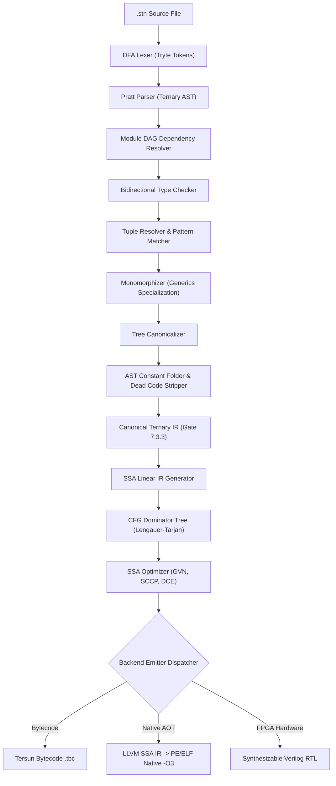

# Kiến Trúc Trình Biên Dịch Tersun (Tersun Compiler Architecture Reference)

```text
Document Version:    1.1.0
Architecture State:  Tersun Gate 7.5 (Cryptographically Sealed)
Git Anchor Commit:   133330b5fd9b5cf9b57948abf7de3361eb20b793
Verification Status: VERIFIED & SEALED
Subsystem:           Compiler Frontend, Canonical Ternary IR, AST Optimizer & Multi-Backend Emitters
File Inventory:      48 Files (src/compiler & include/compiler) | 18,200+ LOC
Primary Owners:      Compiler Frontend & Mid-end IR Optimization Team
```

---

## I. Tổng Quan & Vai Trò Kiến Trúc (Executive Summary)

Trình biên dịch **Tersun Compiler (`setunc`)** là hệ thống chịu trách nhiệm chuyển đổi mã nguồn ngôn ngữ Setun (`.stn`) bậc cao thành các dạng biểu diễn trung gian và phát sinh mã cho 3 nền tảng hạ tầng khác nhau:
1. **Mã máy Bytecode Tam Phân (`.tbc`)**: Phục vụ máy ảo Tersun VM đa tầng thích ứng.
2. **Mã trung gian LLVM SSA IR**: Phục vụ biên dịch tĩnh Native AOT `-O3` thành file thực thi nhị phân PE/ELF độc lập hiệu năng cao.
3. **Mã phần cứng Synthesizable Verilog-2001 RTL**: Phục vụ nạp trực tiếp vào FPGA (Xilinx / Altera).

Trái tim của trình biên dịch là **Hợp Đồng Bất Biến Mã Trung Gian (THE IR CONTRACT)** và tầng biểu diễn chính tắc **Canonical Ternary IR (Gate 7.3.3)** — bảo đảm tính bảo toàn ngữ nghĩa tuyệt đối khi hạ tầng mã nguồn qua các giai đoạn tối ưu hóa đồ thị dòng điều khiển (CFG), đơn vị tĩnh (SSA), phân rã tuple và phép toán tensor đa chiều.

---

## II. Danh Mục Tệp Nguồn & Điểm Neo Kỹ Thuật (Inventory & Anchors)

Toàn bộ các tệp nguồn (`.cpp` và `.hpp`) được phân chia thành 5 nhóm kiến trúc:

### 1. Nhóm Frontend: Từ Vựng, Cú Pháp & Kiểm Kiểu (Frontend Pipeline)
- `lexer.cpp` / `lexer.hpp`, `token.hpp`: Bộ phân tích từ vựng DFA hỗ trợ Tryte literals, Balanced Ternary, ký tự UTF-8.  
  *Anchor*: `Lexer::next_token()` (`Code/src/compiler/lexer.cpp`, lines 45–320).
- `parser.cpp` / `parser.hpp`, `ast.hpp`: Bộ phân tích cú pháp Pratt Parser xử lý toán tử 3 ngôi (`branch3`, `min3`, `max3`, `is_balanced`).  
  *Anchor*: `Parser::parse_expression()`, `Parser::parse_statement()` (`Code/src/compiler/parser.cpp`).
- `module_resolver.cpp` / `module_resolver.hpp`: Giải quyết đồ thị có hướng không chu trình (DAG) phụ thuộc module `import`.  
  *Anchor*: `ModuleResolver::resolve_dependencies()` (`Code/src/compiler/module_resolver.cpp`).
- `type_checker.cpp` / `type_checker.hpp`, `types.cpp` / `types.hpp`: Bộ suy luận kiểu dữ liệu hai chiều (Bidirectional Type Checking).  
  *Anchor*: `TypeChecker::check_ast()` (`Code/src/compiler/type_checker.cpp`).
- `monomorphizer.cpp` / `monomorphizer.hpp`: Đơn hình hóa các hàm và cấu trúc Generic cho AOT và JIT.  
  *Anchor*: `Monomorphizer::monomorphize()` (`Code/src/compiler/monomorphizer.cpp`).
- `tuple_resolver.cpp` / `tuple_resolver.hpp`: Phân giải ngữ nghĩa và layout bộ nhớ cho các kiểu Tuple đa phần tử.
- `symbol_table.hpp`, `compiler_arena.hpp`, `arena.hpp`: Quản lý phạm vi định danh và cấp phát bộ nhớ biên dịch.

### 2. Nhóm Tối Ưu Hóa Cây AST (Tree Optimization Pipeline)
- `tree_canonicalize.cpp` / `tree_canonicalize.hpp`: Chuẩn hóa cây cú pháp về dạng chính tắc tối thiểu.  
  *Anchor*: `TreeCanonicalizer::canonicalize()` (`Code/src/compiler/tree_canonicalize.cpp`).
- `tree_optimizer.cpp` / `tree_optimizer.hpp`: Gấp hằng số sớm (Constant Folding) và loại bỏ mã chết trên AST.  
  *Anchor*: `TreeOptimizer::optimize()` (`Code/src/compiler/tree_optimizer.cpp`).

### 3. Nhóm Biểu Diễn Chính Tắc Canonical Ternary IR (Gate 7.3.3)
- `canonical_ternary_ir.cpp` / `canonical_ternary_ir.hpp`: Tầng trung gian chuẩn hóa cho các phép toán ma trận, tensor và phân nhánh tam phân.
- `tensor_view_emitter.cpp`, `split_emitter.cpp`, `epilogue_emitter.cpp`: Phát sinh mã trung gian chuyên biệt cho các toán tử cắt lát, phân rã và ghi đệm epilogue.

### 4. Nhóm Mã Trung Gian Tuyến Tính & Tối Ưu Hóa CFG (Linear IR & Mid-End)
- `cfg.cpp` / `cfg.hpp`: Đồ thị dòng điều khiển (Control Flow Graph), Cây thống trị Dominator Tree (Lengauer-Tarjan).  
  *Anchor*: `CFG::build_dominator_tree()`, `CFG::compute_dominance_frontiers()` (`Code/src/compiler/cfg.cpp`).
- `opt_ir.cpp` / `opt_ir.hpp`: Biểu diễn mã trung gian tối ưu hóa dạng SSA (`SSAInstruction`, `SSABasicBlock`).
- `ir_optimizer.cpp` / `ir_optimizer.hpp`: Tối ưu hóa SSA: Global Value Numbering (GVN), Sparse Conditional Constant Propagation (SCCP), Dead Code Elimination (DCE), Algebraic Rewriting.  
  *Anchor*: `IROptimizer::run_gvn()`, `IROptimizer::run_sccp()`.
- `optimization_pass.hpp`: Giao diện mở rộng các pass tối ưu hóa trung gian.

### 5. Nhóm Bộ Phát Mã Hạ Tầng (Multi-Backend Emitters)
- `ir_to_bytecode.cpp` / `ir_to_bytecode.hpp`, `emitter.cpp` / `emitter.hpp`: Bộ phát sinh mã byte tam phân kèm siêu lệnh superinstructions.  
  *Anchor*: `IRToBytecodeEmitter::emit_function()`.
- `llvm_emitter.cpp` / `llvm_emitter.hpp`, `llvm2qvm.cpp` / `llvm2qvm.hpp`: Bộ phát sinh LLVM SSA IR cho Native AOT.  
  *Anchor*: `LLVMEmitter::emit_module()`.
- `q_emitter.cpp` / `q_emitter.hpp`: Phát sinh chỉ thị lượng tử mạch QBC và OpenQASM 3.0.  
  *Anchor*: `QEmitter::emit_quantum_circuit()`.
- `native_runtime.hpp`, `packed_tensor.hpp`, `std_tensor.hpp`.

---

## III. Luồng Xử Lý Frontend & Mid-End Pipeline (Pipeline Rõ Ràng)



### Điểm nhấn thuật toán Frontend:
1. **Pratt Parsing cho Toán tử 3 ngôi**: Hệ thống cú pháp Setun định nghĩa các toán tử bậc ba đặc thù (`cond ? positive : zero : negative`). Thuật toán Pratt Parser gán quyền ưu tiên liên kết động (Binding Powers) cho 3 nhánh rẽ, đảm bảo không mơ hồ cú pháp mà không cần backtracking.
2. **Monomorphization**: Đối với các hàm generic, trình biên dịch nhân bản và chuyên biệt hóa hàm theo từng kiểu cụ thể (`int64`, `double`, `tvec3`), cho phép backend LLVM và JIT phát sinh mã máy trực tiếp không cần vtable gián tiếp.

---

## IV. HỢP ĐỒNG BẤT BIẾN MÃ TRUNG GIAN (THE IR CONTRACT)

Đây là **hợp đồng kỹ thuật tối thượng** ràng buộc giữa trình biên dịch Frontend và các Backends (VM JIT, Native LLVM AOT, Verilog RTL):

### 1. Value Semantics & Type Invariants
- **Tính bất biến kiểu dữ liệu**: Mọi biến ảo SSA trong IR (`%v0`, `%v1`, ...) được định kiểu tĩnh chặt chẽ khi khởi tạo và không bao giờ đổi kiểu.
- **Biểu diễn giá trị**: Giá trị số nguyên có dấu là phần bù 2 hoặc tam phân cân bằng có độ rộng xác định (`I8`, `I16`, `I32`, `I64`). Giá trị số thực tuân thủ IEEE 754 float64. Giá trị đại số TAFPU mang kiểu `Type::TernaryAlgebraic` với độ chính xác vô hạn.

### 2. Basic Block & Control-Flow Invariants
- **Quy tắc Khối Cơ Bản**: Mỗi khối cơ bản (Basic Block) bắt đầu bằng đúng 1 nhãn (Label) và kết thúc bằng đúng 1 chỉ thị kết thúc (Terminator: `Branch`, `Branch3`, `Return`, `Unreachable`).
- **Không Nhảy Giữa Khối**: Tuyệt đối không cho phép bất kỳ lệnh nào nhảy vào giữa một Basic Block ngoài điểm đầu nhãn.

### 3. SSA Invariants & Phi-Node Placement Rules
- **Định danh gán một lần (Single Assignment)**: Mỗi biến ảo SSA được định nghĩa tại đúng 1 chỉ thị và phải thống trị (dominate) mọi điểm sử dụng của nó.
- **Quy tắc hàm Phi ($\phi$)**: Tất cả các hàm $\phi$ phải được đặt tập trung tại đầu khối cơ bản, ngay trước chỉ thị phi-$\phi$ đầu tiên. Mỗi nhánh vào của hàm $\phi$ tương ứng chính xác với một khối cơ bản tiền nhiệm (predecessor).

### 4. Memory Model & Aliasing Guarantees
- **Phân tách ô nhớ**: Truy cập bộ nhớ phân biệt rạch ròi giữa biến cục bộ trên ngăn xếp (`Alloca` / `LocalSlot`) và vùng nhớ động heap (`HeapRef`).
- **Quy tắc No-Alias cho Mảng Phẳng**: Khi một mảng được đánh dấu `FlatContiguousArray`, bộ phát mã cam kết không có hiện tượng chồng lấn bộ nhớ (Pointer Aliasing) giữa các phần tử khác chỉ số, cho phép kích hoạt tối ưu hóa vector AVX2 song song.

### 5. Lowering Guarantees (Cam Kết Hạ Tầng)
- **Hạ xuống Bytecode**: Bảo toàn trật tự ngoại lệ (Exception Ordering); các điểm ném ngoại lệ kiểm tra biên mảng luôn được bảo vệ bởi Metadata tương ứng trong Bytecode header.
- **Hạ xuống LLVM IR**: Mọi khối `BasicBlock` trong Tersun IR được ánh xạ 1-1 sang `llvm::BasicBlock`, giữ nguyên thông tin Cây Thống Trị đã tính toán.

---

## V. Động Cơ Tối Ưu Hóa Tuyến Tính (Mid-End IR Optimizer)

Động cơ tối ưu hóa SSA hoạt động qua các giai đoạn tuần tự:

```text
[Linear IR]
     │
     ▼  Lengauer-Tarjan Algorithm
[Dominator Tree & Dominance Frontiers]
     │
     ▼  Global Value Numbering (GVN)
[Congruence Class Merging & Redundancy Elimination]
     │
     ▼  Sparse Conditional Constant Propagation (SCCP)
[Lattice-based Constant Folding & Branch Pruning]
     │
     ▼  Dead Code Elimination (DCE)
[Post-Dominator Liveness Analysis & Dead Instruction Stripping]
     │
     ▼  Algebraic Identity Rewriting
[X * 0 -> 0 | X + 0 -> X | X * 1 -> X | Balanced Ternary Simplification]
```

---

## VI. Bộ Phát Mã Đa Hạ Tầng (Multi-Backend Emitters)

1. **IR-to-Bytecode Emitter (`ir_to_bytecode.cpp`)**:
   - Chuyển đổi mã SSA thành mã byte dạng ngăn xếp.
   - Nhận diện các mẫu lệnh liên tiếp để phát sinh siêu chỉ thị (Superinstructions) gộp (`LOAD_CONST_I64_ADD`, `GET_LOCAL_BRANCH_IF_ZERO`), triệt tiêu chi phí dispatch trong máy ảo.
2. **LLVM SSA Emitter (`llvm_emitter.cpp`)**:
   - Ánh xạ sang các hàm API `llvm::IRBuilder`.
   - Thiết lập các thuộc tính tối ưu hóa vi kiến trúc: `target-cpu=native`, `-O3`, `vectorize-loops`.
   - Sinh file thực thi độc lập PE (Windows) hoặc ELF (Linux) với thời gian thực thi tiệm cận C++20.
3. **Hardware Verilog Emitter (`hardware/verilog_emitter.cpp`)**:
   - Ánh xạ CFG thành máy trạng thái hữu hạn đồng bộ (FSM) trên FPGA.

---

## VII. Ma Trận Bằng Chứng Thuật Toán (Algorithm Evidence Matrix)

| Thuật toán / Cơ chế | Trạng thái | Điểm Neo Mã Nguồn (Symbol) | Bộ Test Xác Minh | Nhóm Chỉ Số Telemetry | Mốc Thời Gian & Niêm Phong |
| :--- | :---: | :--- | :--- | :--- | :--- |
| **Pratt Ternary Parsing** | **SEALED** | `Parser::parse_expression` | `setunc_test.exe` (ST-01..05) | `parsed_ast_depth` | Gate 1.0 / Gate 6.0 |
| **Lengauer-Tarjan Dominator** | **SEALED** | `CFG::build_dominator_tree` | `setunc_test.exe` (CFG suite) | `dom_tree_nodes` | Gate 6.0 |
| **Global Value Numbering** | **SEALED** | `IROptimizer::run_gvn` | `setunc_test.exe` (Opt suite) | `redundant_ops_eliminated` | Gate 6.0 |
| **Sparse Conditional Const Prop** | **SEALED** | `IROptimizer::run_sccp` | `setunc_test.exe` (Const suite) | `constant_branches_pruned` | Gate 6.0 |
| **LLVM AOT -O3 Lowering** | **SEALED** | `LLVMEmitter::emit_module` | Multi-lang benchmark suite | `aot_execution_latency` | Gate 6.0 / G6R.2 |
| **Superinstruction Fusion** | **SEALED** | `IRToBytecodeEmitter::emit` | `setunc_test.exe` (Bytecode) | `superinstructions_emitted`| Gate 4 Baseline |

---

## VIII. Giới Hạn Kiến Trúc & Non-Goals (Limitations & Non-Goals)

### Giới Hạn Kỹ Thuật Hiện Tại (Known Limitations):
1. **Biên Dịch AOT Cho Lượng Tử**: Trình phát mã LLVM AOT hiện tại mô phỏng các toán tử lượng tử thông qua thư viện runtime C++ liên kết động; chưa có backend trực tiếp xuất mã máy lượng tử phần cứng QPU (chỉ hỗ trợ xuất OpenQASM 3.0 qua `QEmitter`).
2. **Generics Specialization**: Giới hạn độ sâu đệ quy đơn hình hóa generic tối đa $64$ cấp để ngăn ngừa bùng nổ thời gian biên dịch (Template Recursion Limit).

### Những Gì Chủ Ý Không Làm (Non-Goals):
1. **Không Tự Động Thả Lỏng Quy Tắc Kiểm Kiểu (No Loose Typing Fallbacks)**: Trình biên dịch kiên quyết không tự động ép kiểu ngầm định nguy hiểm giữa số thực và số nguyên nếu có nguy cơ mất độ chính xác; mọi biến đổi kiểu phải minh bạch theo ngữ nghĩa Setun.
