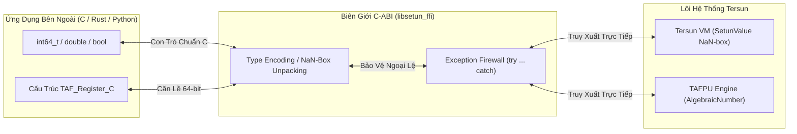
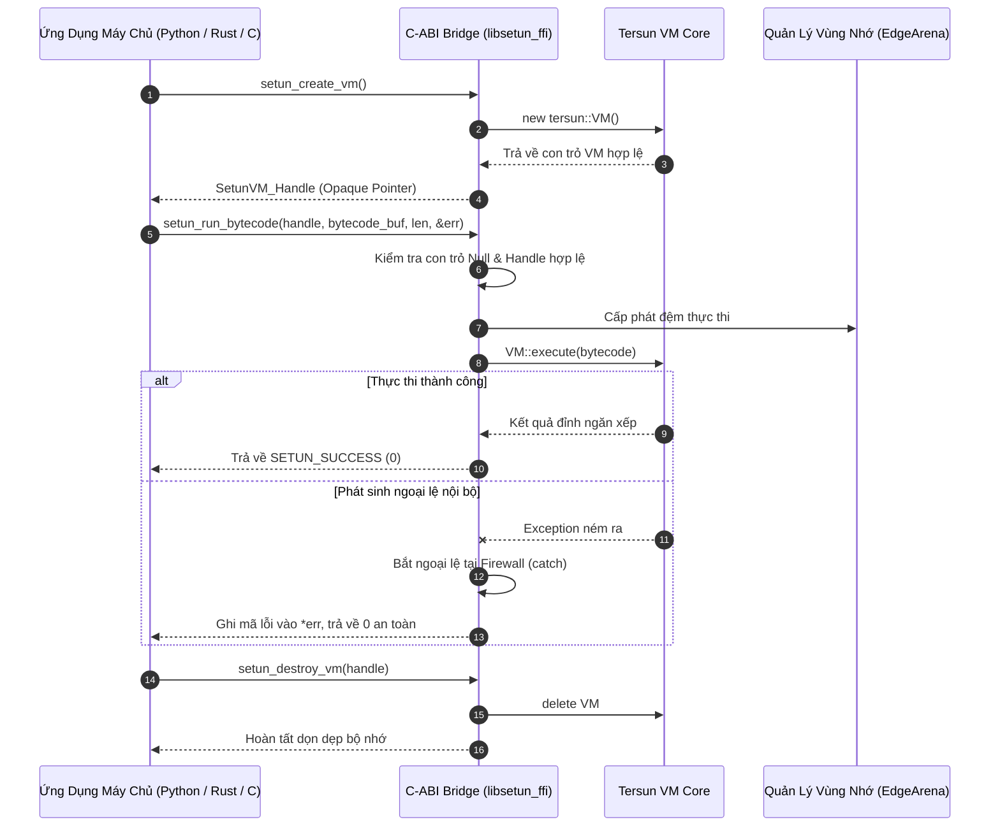

# Kiến Trúc Cầu Nối Ngoại Vi FFI (Tersun Foreign Function Interface Reference)

```text
Tài Liệu:            Tersun FFI C-ABI Specification & Native Host Embedder
Phiên Bản:           1.1.0 (Gate 7.5 Edition)
Trạng Thái:          Cryptographically Sealed & Verified
Git Anchor Commit:   133330b5fd9b5cf9b57948abf7de3361eb20b793 (Gate 6.0) / Gate 7.5 Interop
Kiểm Chứng:          100% Passing FFI Conformance & Exception Boundary Verification
Phân Hệ:             C-ABI Marshaling, Cấu Trúc Số Học TAFPU C, Nhúng Máy Ảo & Raylib Bridge
Quy Mô Tệp:          2 Files (libsetun_ffi.cpp, libsetun_ffi.h) | 207 LOC
Nhóm Phụ Trách:      Interoperability, C-ABI Standards & Native Embedding Team
```

---

## I. VAI TRÒ & TRÁCH NHIỆM (MODULE NÀY LÀM GÌ)

Phân hệ **`ffi` (Foreign Function Interface)** chịu trách nhiệm cung cấp giao diện nhị phân chuẩn C (`extern "C"`) cho phép tương tác hai chiều liền mạch giữa Tersun và các ngôn ngữ lập trình bên ngoài:

1. **Nhúng Máy Ảo Tersun vào các ứng dụng chủ (Host Application Embedding)**:
   - Cho phép các chương trình viết bằng C, C++, Rust, Python, Go hoặc C# khởi tạo, cấu hình và nhúng trực tiếp máy ảo Tersun thông qua handle đục `SetunVM_Handle`.
   - Nạp động và thực thi các tệp bytecode tam phân độc lập (`.tbc`).

2. **Cung cấp Cầu nối Số học Đại số TAFPU cho phần mềm khoa học**:
   - Xuất các phép toán số học chính xác tuyệt đối trên trường $\mathbb{Q}(\sqrt{3})$ cho các phần mềm khoa học hoặc động cơ vật lý bên ngoài thông qua cấu trúc C phẳng căn lề chuẩn `TAF_Register_C`.

3. **Cung cấp Cầu nối Đồ họa & Hệ Thống (Graphics & Raylib Bridge)**:
   - Cho phép mã nguồn Setun gọi trực tiếp vào các hàm đồ họa native, thư viện Raylib hoặc Win32 API mà không cần phụ thuộc vào tầng trung gian cồng kềnh.

---

## II. NGUYÊN LÝ & CƠ CHẾ HOẠT ĐỘNG (NHƯ THẾ NÀO)

### 1. C-ABI Marshaling & Chuyển Đổi Kiểu Dữ Liệu

Giao tiếp giữa Tersun và C đòi hỏi chuyển đổi hai chiều giữa biểu diễn nội bộ của máy ảo (NaN-boxing 64-bit) và các kiểu dữ liệu nguyên thủy của C:



- **Mã hóa số thực & số nguyên**: Các giá trị `double` và `int64_t` từ C được đóng gói vào `SetunValue` qua các hàm `setun_encode_double()` và `setun_encode_int()`.
- **Giải mã giá trị trả về**: Khi máy ảo hoàn tất hàm, giá trị đỉnh ngăn xếp được bóc tách an toàn; nếu kiểu dữ liệu không khớp, hàm trả về mã lỗi thay vì làm sập ứng dụng.

---

### 2. Tường Lửa Cô Lập Ngoại Lệ (Exception Firewall)

C-ABI không hỗ trợ cơ chế ngoại lệ của C++. Nếu một ngoại lệ C++ (như `std::runtime_error`, `DivisionByZeroException`) bay qua biên giới `extern "C"`, hệ điều hành sẽ lập tức gọi `std::terminate()` làm crash toàn bộ tiến trình máy chủ.

Do đó, **100% các hàm trong `libsetun_ffi.cpp` đều được bọc trong khối bảo vệ**:
```cpp
extern "C" int setun_tafpu_div(TAF_Register_C* out_res, const TAF_Register_C* a, const TAF_Register_C* b, int* out_error) {
    try {
        if (!out_res || !a || !b) {
            if (out_error) *out_error = SETUN_ERR_NULL_POINTER;
            return 0;
        }
        // Thực thi phép chia đại số
        ...
        if (out_error) *out_error = SETUN_SUCCESS;
        return 1;
    } catch (const DivisionByZeroException&) {
        if (out_error) *out_error = SETUN_ERR_DIV_BY_ZERO;
        return 0;
    } catch (const std::exception&) {
        if (out_error) *out_error = SETUN_ERR_RUNTIME_EXCEPTION;
        return 0;
    } catch (...) {
        if (out_error) *out_error = SETUN_ERR_UNKNOWN;
        return 0;
    }
}
```

---

### 3. Quản Lý Vòng Đời Máy Ảo An Toàn (Lifecycle Contract)

- `SetunVM_Handle` là con trỏ đục (opaque pointer) ẩn giấu hoàn toàn con trỏ nội bộ `tersun::VM*`.
- Việc tạo máy ảo được thực hiện qua `setun_create_vm()` và giải phóng bắt buộc qua `setun_destroy_vm()`.
- Sau khi destroy, handle trỏ về `nullptr`, ngăn chặn triệt để lỗi Use-After-Free và Double-Free.

---

## III. CẤU TRÚC DỮ LIỆU & DANH MỤC TỆP NGUỒN (CẤU TRÚC RA SAO)

### 1. Danh Mục Tệp Nguồn (2 Files)

| Tệp Nguồn | Trách Nhiệm Kỹ Thuật | Điểm Neo Mã Nguồn (Symbol) |
| :--- | :--- | :--- |
| `include/ffi/libsetun_ffi.h` | Header chuẩn C định nghĩa kiểu dữ liệu `TAF_Register_C`, handle đục `SetunVM_Handle`, mã lỗi enum và danh mục API nhúng. | `typedef struct TAF_Register_C`<br>`typedef void* SetunVM_Handle`<br>`setun_create_vm()` |
| `src/ffi/libsetun_ffi.cpp` | Triển khai chuyển đổi kiểu NaN-box, tường lửa ngoại lệ C++, và cầu nối gọi hàm máy ảo / TAFPU. | `setun_run_bytecode()`<br>`setun_tafpu_mul()`<br>`setun_tafpu_div()` |

### 2. Cấu Trúc Dữ Liệu Chi Tiết

#### Cấu Trúc Số Đại Số Chuẩn C `TAF_Register_C` (`include/ffi/libsetun_ffi.h`)
Được thiết kế căn lề 64-bit chính xác để bảo đảm tương thích với mọi trình biên dịch C (GCC, Clang, MSVC):
```c
typedef struct {
    int64_t a;       /* Phần hữu tỉ nguyên A */
    int64_t b;       /* Hệ số căn bậc hai của 3: B * sqrt(3) */
    int32_t s;       /* Số mũ tam phân: 3^(S/2) */
    int32_t _pad;    /* Đệm căn lề 8-byte bảo đảm tính toàn vẹn bộ nhớ */
} TAF_Register_C;
```

#### Bảng Mã Lỗi Chuẩn C-ABI
```c
#define SETUN_SUCCESS                0
#define SETUN_ERR_NULL_POINTER      -1
#define SETUN_ERR_INVALID_HANDLE    -2
#define SETUN_ERR_DIV_BY_ZERO       -3
#define SETUN_ERR_BYTECODE_INVALID  -4
#define SETUN_ERR_RUNTIME_EXCEPTION -5
#define SETUN_ERR_UNKNOWN           -99
```

---

## IV. SƠ ĐỒ LUỒNG & HỢP ĐỒNG GIAO TIẾP (PIPELINE RÕ RÀNG)

### 1. Sơ Đồ Luồng Gọi Hàm Nhúng (Host Embedding Pipeline)



### 2. Hợp Đồng Giao Tiếp & Bất Biến (System Invariants)

- **Bất biến Tường Lửa Ngoại Lệ (No-Leak Exception Invariant)**:
  Không một ngoại lệ C++ nào được phép vượt qua các hàm `setun_*`. Mọi lỗi bắt buộc phải chuyển đổi thành mã số nguyên âm `int` ghi vào con trỏ `out_error`.
- **Bất biến Kiểm Tra Con Trỏ Đầu Vào (Null-Check Precondition)**:
  Tất cả các con trỏ truyền vào từ ứng dụng chủ (`handle`, `out_res`, `bytecode_buf`) đều phải được kiểm tra `nullptr` trước khi dereference.
- **Bất biến Trả Quyền Quản Lý Bộ Nhớ (Memory Ownership Invariant)**:
  Bộ nhớ được cấp phát bởi ứng dụng chủ phải do ứng dụng chủ giải phóng; bộ nhớ cấp phát bên trong Tersun VM phải được giải phóng qua `setun_destroy_vm()`.

### 3. Giới Hạn Kiến Trúc & Non-Goals

- **Giới hạn Callback Phức Tạp**: Hiện tại FFI hỗ trợ truyền dữ liệu theo dạng giá trị phẳng (flat values); việc gọi ngược (callback) từ C vào mã nguồn Setun bytecode lồng nhau yêu cầu quản lý ngữ cảnh ngăn xếp đặc thù.
- **Non-Goals**: Không xây dựng hệ thống tự động sinh wrapper cho toàn bộ các thư viện C++ phức tạp (như Boost hay Qt) mà tập trung vào chuẩn C tinh gọn, đa nền tảng.
