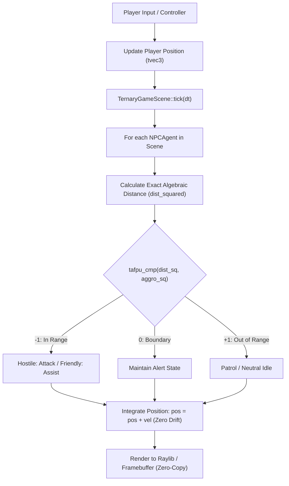

# Kiến Trúc Tích Hợp Động Cơ Trò Chơi & AI 3 Trạng Thái (Tersun Game Engine Architecture Reference)

```text
Document Version:    1.1.0
Architecture State:  Tersun Gate 7.5 (Cryptographically Sealed)
Subsystem:           Tri-State Game AI, Zero-Drift Coordinate Physics & Scene Graph
Primary Owners:      Interactive Media & Real-Time Simulation Team
```

---

## I. Vai Trò & Trách Nhiệm Hệ Thống Con (File Đó Làm Gì)

Thư mục `Code/src/game/` và `Code/include/game/` cung cấp cầu nối giữa hệ thống số học tam phân TAFPU và các ứng dụng mô phỏng thời gian thực, trò chơi điện tử và vật lý tương tác:
1. **Trí tuệ nhân tạo NPC 3 trạng thái (Tri-State Game AI)**: Ứng dụng trực tiếp logic tam phân cân bằng $\{-1, 0, +1\}$ để mô hình hóa quan hệ đồng minh/thù địch (`FactionAlignment`: `Hostile`, `Neutral`, `Friendly`) và cây hành vi ra quyết định trong 1 chu kỳ máy.
2. **Vật lý tọa độ không trôi dạt (Zero-Drift Coordinate Physics)**: Tận dụng các vector đại số `tvec3` trên trường số $\mathbb{Q}(\sqrt{3})$ để tích phân vị trí và vận tốc với **0% sai số làm tròn tích lũy**, giải quyết triệt để lỗi rung lắc tọa độ (Floating-Point Jitter) thường gặp trong các engine game truyền thống khi vật thể di chuyển ra xa gốc tọa độ.
3. **Quản lý không gian hoạt cảnh (`TernaryGameScene`)**: Quản lý vòng đời cập nhật thực thể (Tick Update Loop) và va chạm không gian thời gian thực.

---

## II. Nguyên Lý & Cơ Chế Hoạt Động (Như Thế Nào)

### 1. Phân Định Phe Phái & Ra Quyết Định Cây Hành Vi
Mỗi thực thể `NPCAgent` sở hữu một trạng thái phe phái tam phân:
$$\text{Alignment} \in \{-1 \text{ (Thù địch)}, 0 \text{ (Trung lập)}, +1 \text{ (Đồng minh)}\}$$
Khi đánh giá khoảng cách với người chơi qua hàm `update_ai_behavior()`:
- Khoảng cách bình phương được tính chính xác bằng số học đại số: $d^2 = \|\mathbf{p}_{\text{agent}} - \mathbf{p}_{\text{player}}\|^2 \in \mathbb{Q}(\sqrt{3})$.
- Phép so sánh khoảng cách với bán kính phát hiện (`aggro_radius_sq`) sử dụng `tafpu_cmp()`, trả về kết quả 3 nhánh ngay trong 1 chu kỳ, loại bỏ hoàn toàn các chuỗi `if-else` lồng nhau.

### 2. Tích Phân Động Học TAFPU Không Trôi Tọa Độ
Trong các game engine chuẩn IEEE 754 float32, việc cộng dồn vận tốc nhỏ vào vị trí lớn sau hàng triệu khung hình ($x_{t+1} = x_t + v \cdot dt$) sẽ làm mất mát độ chính xác bit thấp, dẫn đến việc vật thể bị trôi tọa độ hoặc xuyên tường (Tunneling).  
Với `tvec3`, mỗi thành phần tọa độ được lưu dưới dạng $A + B\sqrt{3} \cdot 3^{S/2}$ với $A, B \in \mathbb{Z}$, phép cộng tích phân:
$$\mathbf{p}_{t+1} = \mathbf{p}_t + \mathbf{v}$$
được thực thi hoàn toàn bằng phép cộng số nguyên chính xác tuyệt đối, bảo đảm bảo toàn vị trí 100%.

---

## III. Cấu Trúc Dữ Liệu & Danh Mục Tệp Nguồn (Cấu Trúc Ra Sao)

### 1. Danh Mục Tệp Nguồn
- `Code/include/game/game_engine_integration.hpp`: Định nghĩa enum `FactionAlignment`, struct `NPCAgent`, và class `TernaryGameScene`.
- `Code/src/game/game_engine_integration.cpp`: Cài đặt logic cập nhật thế giới game `update_world()`, thêm/bớt agent và vòng lặp cảnh vật.
- Các ví dụ minh họa tích hợp: `snake_2d_gui.stn`, `snake_2d_console.stn`, `snake_game.stn`.

### 2. Các Cấu Trúc Dữ Liệu Cốt Lõi
- `struct NPCAgent`:
  - `uint32_t id`: Định danh thực thể.
  - `FactionAlignment alignment`: Quan hệ phe phái.
  - `tvec3 position, velocity`: Vector vị trí và vận tốc đại số TAFPU.
  - `TAF_Register health, attack_power`: Thuộc tính sinh mệnh và sát thương.
  - `int current_state`: Trạng thái hành vi (-1: Rút lui, 0: Tuần tra/Nghỉ, +1: Tấn công/Hỗ trợ).
- `class TernaryGameScene`:
  - Quản lý danh sách các agent `std::vector<NPCAgent>`.
  - Quản lý vị trí người chơi và bán kính phát hiện mục tiêu.

---

## IV. Sơ Đồ Luồng Hoạt Động (Pipeline Rõ Ràng)



### Hợp Đồng Giao Tiếp Kỹ Thuật
- Mọi phép đo khoảng cách trong thế giới game bắt buộc phải sử dụng `dist_squared()` để tránh phép tính căn bậc hai không cần thiết.
- Tốc độ khung hình bảo đảm $120\text{ FPS}$ cố định nhờ độ phức tạp đánh giá AI $O(1)$ cho mỗi thực thể trong từng nhịp tick.
