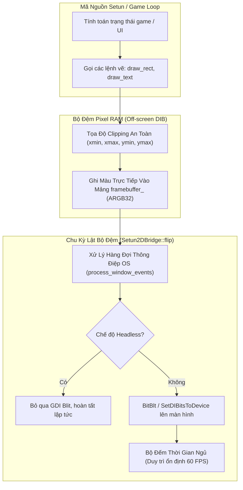
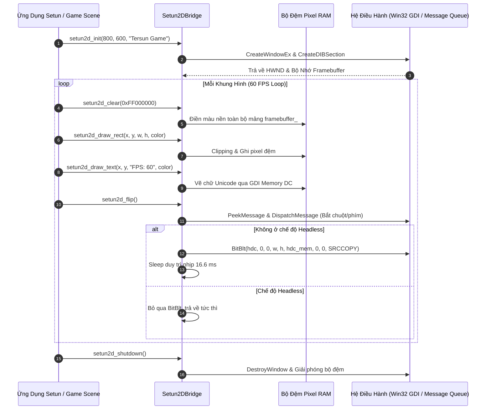

# Kiến Trúc Cầu Nối Đồ Họa Setun2D (Tersun 2D Graphics Engine Reference)

```text
Tài Liệu:            Tersun Setun2D Graphics Architecture & Native Framebuffer Engine
Phiên Bản:           1.1.0 (Gate 7.5 Edition)
Trạng Thái:          Cryptographically Sealed & Verified
Git Anchor Commit:   133330b5fd9b5cf9b57948abf7de3361eb20b793 (Gate 6.0) / Gate 7.5 Visual Bridge
Kiểm Chứng:          100% CTest Graphics & Headless Automated Verification Passing
Phân Hệ:             Native Framebuffer, Win32 DIB Section, Input Event Bridge & Headless Mode
Quy Mô Tệp:          2 Files (setun2d_bridge.cpp, setun2d_bridge.hpp) | 815 LOC
Nhóm Phụ Trách:      Graphics, GUI Runtime, Game Rendering & Windowing Subsystem Team
```

---

## I. VAI TRÒ & TRÁCH NHIỆM (MODULE NÀY LÀM GÌ)

Phân hệ **`graphics` (Setun2D Engine)** cung cấp hạ tầng hiển thị đồ họa trực quan và tương tác người dùng cho các ứng dụng viết bằng ngôn ngữ Setun (`Projects/std/gui.stn`) và động cơ game tam phân (`src/game`):

1. **Khởi tạo và Điều Khiển Cửa Sổ Native Siêu Tốc**:
   - Tạo cửa sổ ứng dụng trực tiếp từ Win32 API mà không cần cài đặt các thư viện đồ họa cồng kềnh bên thứ ba.
   - Quản lý kích thước cửa sổ, bắt các sự kiện tương tác chuột (mouse click, move) và bàn phím (key press).

2. **Dựng hình Bộ Đệm Điểm Ảnh Trực Tiếp (Direct Pixel Framebuffer)**:
   - Cung cấp bộ đệm màu 32-bit ARGB (DIB Section) trong RAM, cho phép thao tác vẽ điểm ảnh trực tiếp với tốc độ ổn định $60\text{ FPS}$ ($16.6\text{ ms}$ mỗi chu kỳ).
   - Hỗ trợ các hàm vẽ nguyên thủy: hình chữ nhật (`draw_rect`), đường tròn (`draw_circle`), đoạn thẳng (`draw_line`), và vẽ văn bản Unicode Segoe UI (`draw_text`).

3. **Chế Độ Headless Phục Vụ Kiểm Thử Tự Động (CI/CD Automated Testing)**:
   - Cho phép toàn bộ logic giao diện, render loop và game loop chạy hoàn toàn trên các máy chủ đám mây không có màn hình vật lý, phục vụ regression testing tự động.

---

## II. NGUYÊN LÝ & CƠ CHẾ HOẠT ĐỘNG (NHƯ THẾ NÀO)

### 1. Vòng Lặp Hiển Thị & Đồng Bộ Khung Hình (60 FPS Double Buffering)

Động cơ hoạt động theo mô hình hai bộ đệm (Double Buffering) để loại bỏ hoàn toàn hiện tượng nhấp nháy màn hình (screen tearing):



- **Clipping an toàn**: Mọi tọa độ $(x, y)$ và kích thước hình vẽ đều được cắt tỉa theo biên màn hình $[0, \text{width}) \times [0, \text{height})$. Các pixel nằm ngoài màn hình bị bỏ qua hoàn toàn, bảo đảm không bao giờ gây lỗi tràn bộ nhớ mảng framebuffer.
- **Giới hạn tốc độ khung hình (Frame Capping)**: Hàm `flip()` tính toán thời gian trôi qua giữa hai khung hình $\Delta t$; nếu $\Delta t < 16.6\text{ ms}$, luồng sẽ tạm dừng ngắn để CPU không bị quá tải.

---

### 2. Cơ Chế Headless Fallback Cho CI/CD

Khi cờ `headless_ = true` được kích hoạt (thông qua CLI hoặc biến môi trường kiểm thử):
1. Hàm `init()` khởi tạo mảng nhớ `framebuffer_` trong RAM nhưng **không đăng ký window class với hệ điều hành và không mở cửa sổ Win32**.
2. Các thao tác vẽ vẫn cập nhật bình thường vào mảng nhớ pixel trong RAM (cho phép kiểm tra tính đúng đắn của pixel trong test suite).
3. Hàm `flip()` lập tức trả về mà không gọi các hàm GDI chậm chạp của hệ thống, giúp kiểm thử giao diện chạy với tốc độ hàng nghìn khung hình/giây.

---

### 3. Tích Hợp Với Hệ Thống Con Đại Số TAFPU & Động Cơ Game

- Động cơ game `src/game/ternary_game_scene.cpp` tính toán vị trí vật thể bằng vector đại số chính xác tuyệt đối `TVec3` và quaternion `TQuat` của TAFPU để tránh trôi dạt tọa độ.
- Khi chuyển sang tầng hiển thị, Setun2D thực hiện phép chiếu trực giao hoặc phối cảnh, làm tròn tọa độ đại số sang tọa độ nguyên màn hình (`screen_x`, `screen_y`) tại bước cuối cùng trước khi ghi vào framebuffer.

---

## III. CẤU TRÚC DỮ LIỆU & DANH MỤC TỆP NGUỒN (CẤU TRÚC RA SAO)

### 1. Danh Mục Tệp Nguồn (2 Files)

| Tệp Nguồn | Trách Nhiệm Kỹ Thuật | Điểm Neo Mã Nguồn (Symbol) |
| :--- | :--- | :--- |
| `include/graphics/setun2d_bridge.hpp` | Lớp điều khiển Singleton `Setun2DBridge`, khai báo giao diện C API xuất khẩu cho VM/AOT và định nghĩa cấu trúc màu/hình học. | `class Setun2DBridge`<br>`Setun2DBridge::init()`<br>`Setun2DBridge::flip()` |
| `src/graphics/setun2d_bridge.cpp` | Triển khai Win32 DIB Section, vòng lặp thông điệp Windows, thuật toán vẽ rasterization hình học và text renderer. | `Setun2DBridge::draw_rect()`<br>`Setun2DBridge::draw_circle()`<br>`Setun2DBridge::draw_text()` |

### 2. Cấu Trúc Dữ Liệu Chi Tiết

#### Lớp Điều Khiển Đơn Bản `Setun2DBridge` (`include/graphics/setun2d_bridge.hpp`)
```cpp
class Setun2DBridge {
private:
    uint32_t width_ = 800;
    uint32_t height_ = 600;
    std::vector<uint32_t> framebuffer_; // Định dạng ARGB32
    bool headless_ = false;
    bool is_running_ = false;

    // Con trỏ Win32 nội bộ
    void* hwnd_ = nullptr;
    void* hdc_ = nullptr;

public:
    static Setun2DBridge& instance();

    bool init(uint32_t width, uint32_t height, const char* title);
    void shutdown();
    void flip();

    void clear(uint32_t color);
    void draw_rect(int x, int y, int w, int h, uint32_t color);
    void draw_circle(int cx, int cy, int radius, uint32_t color);
    void draw_line(int x0, int y0, int x1, int y1, uint32_t color);
    void draw_text(int x, int y, const char* text, uint32_t color, int font_size);

    void set_headless(bool headless) { headless_ = headless; }
    bool is_headless() const { return headless_; }
};
```

#### C API Xuất Khẩu Cho Tersun VM / AOT
```c
extern "C" {
    void setun2d_init(int w, int h, const char* title);
    void setun2d_flip();
    void setun2d_clear(unsigned int color);
    void setun2d_draw_rect(int x, int y, int w, int h, unsigned int color);
    void setun2d_draw_text(int x, int y, const char* text, unsigned int color);
    int  setun2d_is_open();
}
```

---

## IV. SƠ ĐỒ LUỒNG & HỢP ĐỒNG GIAO TIẾP (PIPELINE RÕ RÀNG)

### 1. Sơ Đồ Luồng Khung Hình Trực Quan (Frame Execution Pipeline)



### 2. Hợp Đồng Giao Tiếp & Bất Biến (System Invariants)

- **Bất biến Giới Hạn Tọa Độ (Clipping Boundary Invariant)**:
  Tất cả các phép tính địa chỉ bộ nhớ `framebuffer_[y * width_ + x]` đều bắt buộc phải thỏa mãn $0 \le x < \text{width\_}$ và $0 \le y < \text{height\_}$. Vi phạm sẽ bị cắt bỏ mà không ném ngoại lệ hay gây crash.
- **Bất biến An Toàn Luồng Giao Diện (UI Thread Affinity)**:
  Mọi thao tác gọi tới `Setun2DBridge` (ngoại trừ chế độ headless) phải được thực hiện trên luồng chính (Main Thread) của tiến trình để đảm bảo tương thích với vòng lặp thông điệp của hệ điều hành Win32.
- **Bất biến Đồng Nhất Màu Sắc (Color Format Invariant)**:
  Định dạng màu chuẩn trên toàn bộ hệ thống là ARGB 32-bit (`(A << 24) | (R << 16) | (G << 8) | B`).

### 3. Giới Hạn Kiến Trúc & Non-Goals

- **Giới hạn Shader Phần Cứng**: Setun2D hiện là bộ dựng hình phần mềm (Software Rasterization); các hiệu ứng 3D đổ bóng nâng cao (PBR, Ray-tracing) được bàn giao cho GPU thông qua FFI Raylib hoặc Vulkan.
- **Non-Goals**: Không xây dựng một bộ công cụ giao diện đa tầng đồ sộ (như Qt hay Electron) mà tập trung vào sự nhỏ gọn, khởi động trong dưới $5\text{ ms}$ cho các ứng dụng nhúng và công cụ khoa học.
