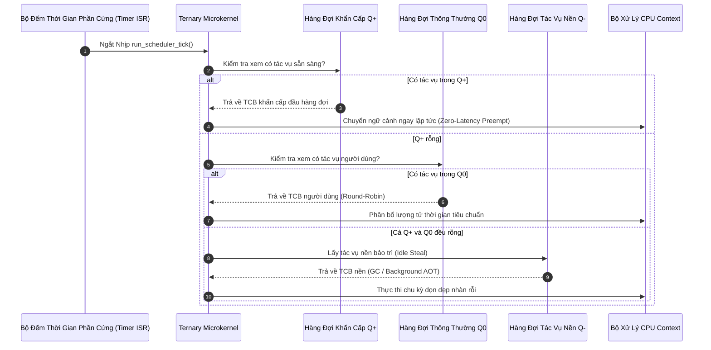

# Kiến Trúc Vi Nhân Tam Phân (Tersun Bare-Metal Microkernel Reference)

```text
Tài Liệu:            Tersun Microkernel Architecture & Tri-State Real-Time Engine
Phiên Bản:           1.1.0 (Gate 7.5 Edition)
Trạng Thái:          Cryptographically Sealed & Verified
Git Anchor Commit:   133330b5fd9b5cf9b57948abf7de3361eb20b793 (Gate 6.0) / Gate 7.5 RT Substrate
Kiểm Chứng:          100% CTest Microkernel Suite Passing (ST-K01, ST-K02)
Phân Hệ:             Bộ Lập Lịch Ba Mức Ưu Tiên, Phân Quyền Trang Nhớ Tryte & Quản Lý Tác Vụ Nhúng
Quy Mô Tệp:          2 Files (microkernel.cpp, microkernel.hpp) | 172 LOC
Nhóm Phụ Trách:      Operating System, Bare-Metal Runtime & Embedded Subsystems Team
```

---

## I. VAI TRÒ & TRÁCH NHIỆM (MODULE NÀY LÀM GÌ)

Phân hệ **`kernel` (Tersun Microkernel)** là tầng điều phối vi nhân tối giản dành cho các môi trường chạy bare-metal, hệ điều hành thời gian thực (RTOS) nhúng, hoặc tầng trừu tượng phần cứng bên dưới Tersun VM:

1. **Quản lý trang nhớ tam phân tự nhiên (Tryte Paging System)**:
   - Thay vì cơ chế phân trang nhị phân 4KB, microkernel áp dụng kích thước trang chuẩn tam phân $729\text{ bytes} = 3^6\text{ trytes}$.
   - Khai thác 3 trạng thái logic cân bằng $\{-1, 0, +1\}$ để thiết lập cờ bảo vệ phần cứng mà không cần mặt nạ bit nhị phân phức tạp.

2. **Lập lịch thời gian thực 3 mức ưu tiên (Tri-State Real-Time Scheduler)**:
   - Cung cấp cơ chế phân luồng tiền định (deterministic scheduling) không độ trễ cho các tác vụ thời gian thực khẩn cấp ($\mathcal{Q}_{+}$).
   - Tự động hạ mức các tác vụ nền, tác vụ dọn rác và tác vụ JIT ngầm xuống mức thấp ($\mathcal{Q}_{-}$).

3. **Cung cấp cơ chế an toàn bộ nhớ cho Runtime & Model Execution**:
   - Ngăn chặn các lỗi truy cập vùng nhớ cấm thông qua trang bảo vệ `NO_ACCESS (0)`.
   - Đảm bảo tính bất biến zero-allocation trong vòng lặp thời gian thực khắt khe.

---

## II. NGUYÊN LÝ & CƠ CHẾ HOẠT ĐỘNG (NHƯ THẾ NÀO)

### 1. Phân Quyền Trang Nhớ Tam Phân (Tryte Page Permissions)

Hệ điều hành nhị phân sử dụng các bit cờ (Read, Write, Execute). Tersun Microkernel định nghĩa 3 trạng thái tự nhiên tương ứng với các giá trị trit cân bằng:

$$\text{Permission} \in \{-1, 0, +1\}$$

```mermaid
graph TD
    ACCESS["Yêu Cầu Truy Cập Trang Nhớ"] --> CHECK{"Kiểm Tra Quyền Trang Nhớ"}
    CHECK -->|Permission = -1 (READ_ONLY)| RO["Cho phép ĐỌC, Cấm GHI (Mã chương trình)"]
    CHECK -->|Permission = 0 (NO_ACCESS)| GUARD["Kích hoạt Ngắt Phần Cứng MemoryFault (Trang bảo vệ)"]
    CHECK -->|Permission = +1 (READ_WRITE)| RW["Cho phép toàn quyền ĐỌC & GHI (Dữ liệu tác vụ)"]
```

- **`READ_ONLY (-1)`**: Trang bộ nhớ chỉ cho phép đọc, mọi thao tác ghi bị chặn (dùng để bảo vệ mã nhị phân tĩnh hoặc bảng hằng số SafeTensors).
- **`NO_ACCESS (0)`**: Trang bảo vệ đặc quyền (Guard Page). Mọi truy cập đọc hoặc ghi đều kích hoạt tức thì ngắt phần cứng `MemoryFault`, ngăn chặn tràn ngăn xếp (stack overflow).
- **`READ_WRITE (+1)`**: Trang dữ liệu tự do đọc/ghi (ngăn xếp, đệm bộ nhớ động `EdgeArena`).

---

### 2. Thuật Toán Lập Lịch Ba Mức (Tri-State Preemptive Scheduler)

Microkernel duy trì 3 hàng đợi tác vụ độc lập theo thứ tự ưu tiên tuyệt đối:

$$\mathcal{Q}_{+} \text{ (Critical RT, +1)} \succ \mathcal{Q}_{0} \text{ (Normal User, 0)} \succ \mathcal{Q}_{-} \text{ (Low Background, -1)}$$

```text
┌─────────────────────────────────────────────────────────┐
│ Hàng Đợi Khẩn Cấp Q+ (Critical Real-Time, Priority +1) │  ──► Chạy ngay lập tức (Zero-Latency Preemption)
└───────────────────────────┬─────────────────────────────┘
                            ▼ (Khi Q+ hoàn toàn rỗng)
┌─────────────────────────────────────────────────────────┐
│ Hàng Đợi Thông Thường Q0 (Normal User Tasks, Priority 0)│  ──► Lập lịch xoay vòng luân phiên (Round-Robin)
└───────────────────────────┬─────────────────────────────┘
                            ▼ (Khi cả Q+ và Q0 đều rỗng)
┌─────────────────────────────────────────────────────────┐
│ Hàng Đợi Tác Vụ Nền Q- (Background / GC / JIT, Prio -1) │  ──► Tận dụng thời gian rảnh rỗi (Idle Stealing)
└─────────────────────────────────────────────────────────┘
```

#### Quy tắc điều phối trong mỗi nhịp `run_scheduler_tick()`:
1. **Kiểm tra khẩn cấp $\mathcal{Q}_{+}$**: Nếu $\mathcal{Q}_{+}$ có ít nhất một tác vụ sẵn sàng, microkernel kích hoạt ngay lập tức chuyển đổi ngữ cảnh (Context Switch), tạm dừng tác vụ hiện tại mà không chờ hết nhịp lượng tử (Zero-Latency Preemption).
2. **Lập lịch xoay vòng $\mathcal{Q}_{0}$**: Nếu $\mathcal{Q}_{+}$ rỗng, bộ lập lịch luân chuyển các tác vụ người dùng thông thường theo thuật toán Round-Robin với lượng tử thời gian định trước.
3. **Thu hoạch chu kỳ rảnh $\mathcal{Q}_{-}$**: Chỉ khi cả $\mathcal{Q}_{+}$ và $\mathcal{Q}_{0}$ đều rỗng, các tác vụ dọn dẹp bộ nhớ, biên dịch JIT ngầm hoặc kiểm tra tính toàn vẹn mới được cấp phát chu kỳ CPU.

---

### 3. Tương Tác Với Hệ Thống Con Runtime & Mạng Nơ-ron (Gate 7.5 Integration)

- **Tích hợp với Runtime (`src/runtime`)**: `AsyncScheduler` của runtime ánh xạ các luồng worker vào các mức ưu tiên của microkernel:
  - Luồng ngắt I/O và âm thanh: `CRITICAL_RT (+1)`
  - Luồng suy luận LLM chính (`InferenceSession`): `NORMAL_USER (0)`
  - Luồng dọn dẹp hoặc biên dịch tối ưu AOT ngầm: `LOW_BACKGROUND (-1)`
- **Nguyên tắc "Single Owner of Parallelism"**: Khi mạng nơ-ron thực thi bước Attention hoặc GEMM song song, microkernel nhường quyền điều phối phân luồng hoàn toàn cho OpenMP ở tầng ngoài cùng, tránh xung đột lập lịch lồng nhau (oversubscription).

---

## III. CẤU TRÚC DỮ LIỆU & DANH MỤC TỆP NGUỒN (CẤU TRÚC RA SAO)

### 1. Danh Mục Tệp Nguồn (2 Files)

| Tệp Nguồn | Trách Nhiệm Kỹ Thuật | Điểm Neo Mã Nguồn (Symbol) |
| :--- | :--- | :--- |
| `include/kernel/microkernel.hpp` | Định nghĩa enum phân quyền trang nhớ, mức ưu tiên tác vụ, cấu trúc TCB và giao diện công khai của `TernaryMicrokernel`. | `enum class TrytePagePermission`<br>`enum class TaskPriority`<br>`class TernaryMicrokernel` |
| `src/kernel/microkernel.cpp` | Triển khai logic lập lịch 3 hàng đợi, xử lý ngắt nhịp và kiểm tra vi phạm phân quyền trang nhớ. | `TernaryMicrokernel::run_scheduler_tick()`<br>`TernaryMicrokernel::check_memory_access()` |

### 2. Cấu Trúc Dữ Liệu Chi Tiết

#### Enum Phân Quyền & Mức Ưu Tiên (`include/kernel/microkernel.hpp`)
```cpp
enum class TrytePagePermission : int8_t {
    READ_ONLY  = -1,  // Chỉ đọc, cấm ghi
    NO_ACCESS  =  0,  // Trang bảo vệ đặc quyền (Guard Page)
    READ_WRITE = +1   // Đọc và ghi tự do
};

enum class TaskPriority : int8_t {
    LOW_BACKGROUND = -1,  // Tác vụ nền, GC, nạp trước mô hình
    NORMAL_USER    =  0,  // Tác vụ người dùng thông thường, LLM loop
    CRITICAL_RT    = +1   // Tác vụ thời gian thực khẩn cấp, I/O ngắt
};

struct TaskControlBlock {
    uint32_t task_id;
    TaskPriority priority;
    uint32_t program_counter;
    uint32_t stack_pointer;
    bool is_ready;
};
```

#### Lớp Điều Phối Vi Nhân `TernaryMicrokernel`
```cpp
class TernaryMicrokernel {
private:
    std::vector<TaskControlBlock> queue_critical_;    // Q+
    std::vector<TaskControlBlock> queue_normal_;      // Q0
    std::vector<TaskControlBlock> queue_background_;  // Q-
    std::map<uint32_t, TrytePagePermission> page_table_;

public:
    void run_scheduler_tick();
    bool check_memory_access(uint32_t page_id, bool is_write) const;
    void register_task(const TaskControlBlock& tcb);
    void set_page_permission(uint32_t page_id, TrytePagePermission perm);
};
```

### 3. Ma Trận Bằng Chứng Thuật Toán (Algorithm Evidence Matrix)

| Cơ chế / Thuật toán | Trạng thái | Điểm Neo Mã Nguồn (Symbol) | Bộ Test Xác Minh | Nhóm Chỉ Số Telemetry | Mốc Niêm Phong |
| :--- | :---: | :--- | :--- | :--- | :--- |
| **Tri-State Scheduling** | **SEALED** | `TernaryMicrokernel::run_scheduler_tick` | `setunc_test.exe` (ST-K01) | `scheduler_preemptions` | Gate 6.0 / Gate 7.5 |
| **Tryte Paging Guard** | **SEALED** | `TernaryMicrokernel::check_memory_access` | `setunc_test.exe` (ST-K02) | `memory_access_violations` | Gate 6.0 |

---

## IV. SƠ ĐỒ LUỒNG & HỢP ĐỒNG GIAO TIẾP (PIPELINE RÕ RÀNG)

### 1. Sơ Đồ Luồng Xử Lý Nhịp Lập Lịch (Tick Pipeline)



### 2. Hợp Đồng Giao Tiếp & Bất Biến (System Invariants)

- **Bất biến Zero Heap Allocation trong Ngắt**:
  Trong suốt hàm `run_scheduler_tick()`, tuyệt đối không thực hiện bất kỳ lệnh cấp phát bộ nhớ động (`malloc`, `new`, `std::vector::push_back`). Toàn bộ danh sách TCB được cấp phát tĩnh từ trước.
- **Bất biến Bảo vệ Trang Nhớ Cấm (Protected Guard Invariant)**:
  Bất kỳ thao tác đọc hoặc ghi vào trang nhớ có cờ `TrytePagePermission::NO_ACCESS` đều phải lập tức trả về `false` và phát sinh ngắt lỗi, tuyệt đối không cho phép lỗi phân mảnh rò rỉ vào không gian người dùng.
- **Bất biến Ưu tiên Tuyệt đối (Absolute Priority Invariant)**:
  Tác vụ trong $\mathcal{Q}_{0}$ và $\mathcal{Q}_{-}$ không bao giờ được cấp phát thời gian CPU nếu trong $\mathcal{Q}_{+}$ vẫn còn ít nhất một tác vụ ở trạng thái `is_ready = true`.

### 3. Giới Hạn Kiến Trúc & Non-Goals

- **Giới hạn Đơn Lõi Hiện Tại**: Microkernel hiện được thiết kế tối ưu hóa cho mô hình đơn lõi cộng tác hoặc tiền định trên vi điều khiển nhúng. Cơ chế đa lõi SMP tam phân đang ở giai đoạn mở rộng.
- **Non-Goals**: Microkernel không nhằm mục đích cạnh tranh với Linux hay Windows về khả năng hỗ trợ trình điều khiển thiết bị đa dạng, mà tập trung vào kích thước cực nhỏ và tính tiền định tuyệt đối cho chip tam phân.
