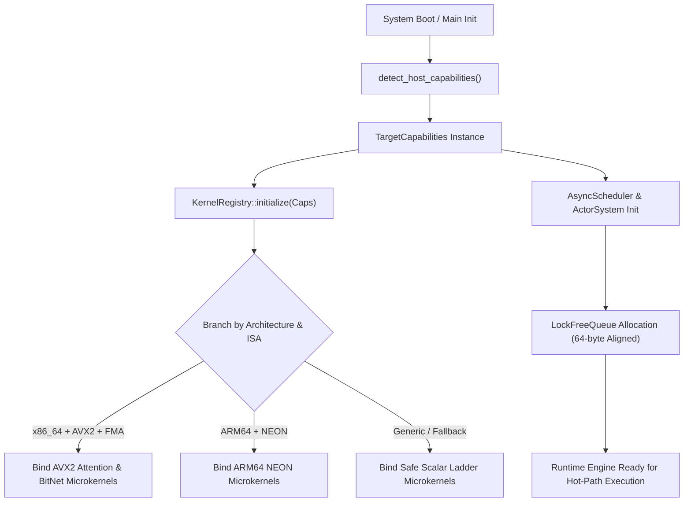

# Kiến Trúc Tầng Thực Thi Cơ Sở (Tersun Core Runtime Architecture Reference)

```text
Document Version:    1.1.0
Architecture State:  Tersun Gate 7.5 (Cryptographically Sealed)
Subsystem:           Hardware Capability Discovery, Kernel Registry, Actor System & Lock-Free Runtime
Primary Owners:      Core Systems & Runtime Infrastructure Team
```

---

## I. Vai Trò & Trách Nhiệm Hệ Thống Con (File Đó Làm Gì)

Thư mục `Code/src/runtime/` và `Code/include/runtime/` cung cấp nền tảng hạ tầng thực thi cấp thấp cho toàn bộ các hệ thống con của Tersun (Compiler, VM, JIT, QVM, Tensor Engine):
1. **Phát hiện năng lực phần cứng tại chỗ (`target_capabilities.hpp/cpp`)**: Quét tập chỉ thị CPUID lúc khởi động (AVX2, FMA, NEON, RVV, số lõi logic, ngân sách bộ nhớ).
2. **Đăng ký và điều phối vi nhân động (`kernel_registry.hpp/cpp`)**: Ánh xạ linh hoạt giữa các toán tử cấp cao và các vi nhân tối ưu phần cứng thích hợp nhất (`KernelABI`).
3. **Mô hình đồng quy Actor không chia sẻ (`actor_system.hpp`)**: Hệ thống Actor đa luồng truyền thông điệp Zero-Copy $O(1)$ qua con trỏ độc quyền, miễn nhiễm hoàn toàn với Data Races và Deadlocks.
4. **Hàng đợi không khóa siêu tốc (`lockfree_queue.hpp`)**: Hàng đợi MPMC (Multi-Producer Multi-Consumer) Dmitry Vyukov với độ trễ ghi/đọc nano giây, phục vụ điều phối sự kiện và tác vụ.
5. **Bộ lập lịch bất đồng bộ 3 mức ưu tiên (`async_scheduler.hpp`)**: Điều phối Coroutines thời gian thực theo logic tam phân $\{-1, 0, +1\}$.

---

## II. Nguyên Lý & Cơ Chế Hoạt Động (Như Thế Nào)

### 1. Tự Động Thích Ứng Vi Kiến Trúc (Hardware Discovery & Kernel Binding)
Khi hệ thống khởi động:
1. `detect_host_capabilities()` gọi các chỉ thị nội tại CPUID (trên x86-64) hoặc thanh ghi hệ thống `mrs` (trên ARM64).
2. Kết quả điền vào `TargetCapabilities`: nhận diện chính xác độ rộng thanh ghi vector (`vector_bytes = 32` cho AVX2, `16` cho NEON), hỗ trợ FMA, và số lượng lõi CPU logic.
3. `KernelRegistry` tự động lựa chọn hàm tối ưu: nếu phát hiện AVX2 + FMA $\implies$ trỏ con trỏ hàm sang `bitnet_avx2` và `attention_kernels_avx2`; nếu không $\implies$ lùi về `bitnet_scalar_ladder`.

### 2. Mô Hình Share-Nothing Actor & Lock-Free Mailbox
Mỗi Actor sở hữu một luồng độc lập hoặc được lập lịch trên sợi nhẹ (Fiber). Hòm thư (Mailbox) của Actor sử dụng cấu trúc vòng tròn không khóa `LockFreeQueue` căn chỉnh theo dòng nhớ cache (Cache-Line Aligned: 64 bytes) để triệt tiêu hiện tượng False Sharing giữa các lõi CPU.  
Việc truyền thông điệp là thao tác chuyển giao quyền sở hữu con trỏ độc quyền (Exclusive Pointer Move), hoàn toàn không sao chép sâu bộ nhớ.

---

## III. Cấu Trúc Dữ Liệu & Danh Mục Tệp Nguồn (Cấu Trúc Ra Sao)

### 1. Danh Mục Tệp Nguồn
- `Code/include/runtime/target_capabilities.hpp` & `Code/src/runtime/target_capabilities.cpp`:
  - `enum class Architecture`: `Generic`, `X86_64`, `ARM64`, `RISCV64`, `TernaryEmulated`.
  - `enum class MemoryProfile`: `DesktopHeap` (cấp phát tự do), `EdgeArena` (cố định không malloc).
  - `struct TargetCapabilities`: Cấu trúc thuộc tính phần cứng và bộ nhớ.
- `Code/include/runtime/kernel_registry.hpp` & `Code/src/runtime/kernel_registry.cpp`:
  - Bảng ánh xạ định danh toán tử $\to$ con trỏ hàm vi nhân SIMD.
- `Code/include/runtime/kernel_abi.hpp`: Quy ước gọi hàm và bố cục tham số chuẩn cho các vi nhân C++.
- `Code/include/runtime/actor_system.hpp`: Hệ thống Actor, định danh `ActorRef`, và chu trình xử lý thông điệp.
- `Code/include/runtime/lockfree_queue.hpp`: Hàng đợi MPMC vòng tròn phi khóa.
- `Code/include/runtime/async_scheduler.hpp`: Bộ điều phối Coroutines theo 3 mức ưu tiên tam phân.

### 2. Các Ràng Buộc Bất Biến (Invariants)
- Khi `memory_profile == MemoryProfile::EdgeArena`, biến `allow_heap_on_hot_path` phải luôn bằng `false`.
- Các cấu trúc dữ liệu không khóa phải áp dụng bộ nhớ tuần tự hóa `std::memory_order_acquire` / `std::memory_order_release` chính xác, không dùng cờ lỏng lẻo (`relaxed`) trên các biến cờ đồng bộ.

---

## IV. Sơ Đồ Luồng Khởi Tạo & Điều Phối Runtime (Pipeline Rõ Ràng)



### Hợp Đồng Đăng Ký Vi Nhân (Kernel Registration Contract)
Mọi vi nhân khi đăng ký vào `KernelRegistry` bắt buộc phải cung cấp cờ kiểm định an toàn (Safety Flags):
```cpp
registry.register_kernel(KernelOp::BitNetGEMM, Architecture::X86_64, Feature::AVX2 | Feature::FMA, &gemm_avx2_fma_kernel);
```
Nếu nền tảng phần cứng hiện tại thiếu bất kỳ cờ tính năng nào, hệ thống tự động từ chối và lùi về phương án an toàn kế tiếp.
