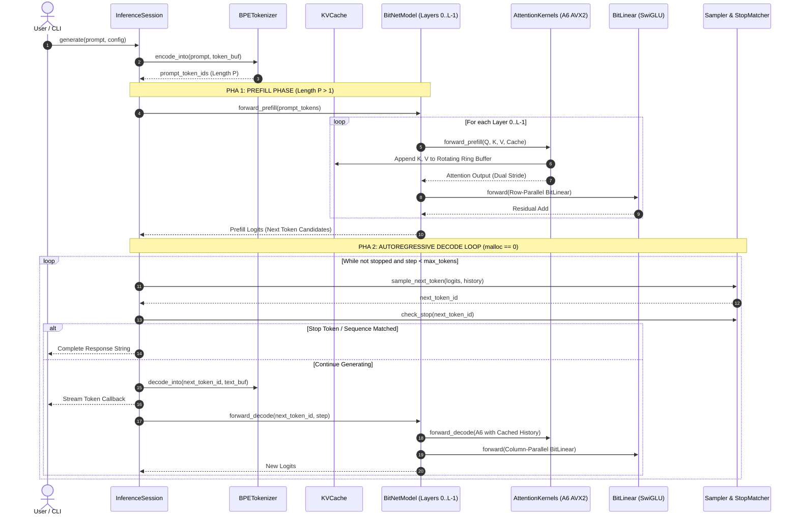

# Kiến Trúc Tầng Mô Hình Mạng Nơ-ron Transformer & BitNet (Tersun Neural Network Architecture Reference)

```text
Document Version:    1.1.0
Architecture State:  Tersun Gate 7.5 (Cryptographically Sealed)
Subsystem:           BitNet-b1.58 Transformer Engine, FlashAttention Ladder & Zero-Alloc Runtime
Primary Owners:      AI Model Runtime & Microkernel Optimization Team
```

---

## I. Vai Trò & Trách Nhiệm Hệ Thống Con (File Đó Làm Gì)

Thư mục `Code/src/tensor/nn/` và `Code/include/tensor/nn/` cấu thành **Động cơ Thực thi Mô hình Ngôn ngữ Lớn Bản địa (Native LLM Inference Runtime)** của hệ sinh thái Tersun. Hệ thống con chịu trách nhiệm:
1. **Quản lý tài nguyên gói mô hình (`format/`)**: Phân tích cú pháp cấu hình `config.json` (`ModelManifest`), nạp file SafeTensors (`ModelPackage`), mã hóa từ vựng Byte-Level BPE không cấp phát (`ITokenizer`) và định dạng mẫu hội thoại ChatML (`ChatTemplate`).
2. **Quản lý bộ nhớ đệm ngữ cảnh (`memory/`)**: Cung cấp cấu trúc `KVCache` phân khối xoay vòng, duy trì tính đúng đắn vi sai giữa Prefill và Incremental Decode.
3. **Mô hình hóa cấu trúc Transformer (`models/`)**: Triển khai `BitNetModel`, `DecoderBlock`, `FeedForward` (SwiGLU).
4. **Vi nhân toán tử nơ-ron tối ưu (`ops/`)**:
   - `attention_kernels.hpp/cpp`: Thang tối ưu hóa Attention 7 bậc ($A_0 \to A_6$) với vi nhân AVX2 FMA 4 chuỗi song song.
   - `bit_linear.hpp/cpp`: Lớp tuyến tính Shape-Aware (Prefill row-parallel vs Decode column-parallel).
   - `rmsnorm.hpp/cpp`, `rope.hpp/cpp`, `activations.hpp/cpp`.
5. **Điều phối phiên suy luận (`runtime/`)**:
   - `inference_session.hpp/cpp`: Quản lý toàn bộ vòng đời sinh tự hồi quy bảo đảm `malloc == 0`.
   - `sampler.hpp`: Hợp đồng lấy mẫu 7 bước (Repetition, Presence, Frequency Penalties, Temp, Top-K, Top-P).
   - `parallel_planner.hpp/cpp`: Cơ chế Single Owner of Parallelism điều phối OpenMP không lồng ghép.

---

## II. Nguyên Lý & Cơ Chế Hoạt Động (Như Thế Nào)

### 1. Thang Tối Ưu Hóa Attention 7 Bậc ($A_0 \to A_6$)
Tại [`attention_kernels.cpp`](file:///d:/New%20PJ/Ternary/Compiler/Code/src/tensor/nn/ops/attention_kernels.cpp), hiệu năng Attention được gia tốc theo từng bậc có thể kiểm chứng:
- **$A_0$ (Scalar Reference)**: Softmax 2 lượt chuẩn, lưu ma trận $S \times S$ (Frozen Oracle).
- **$A_1$ (Online Scalar)**: FlashAttention 1 lượt duy trì $m_i, l_i, O_i$, triệt tiêu $S \times S$ scratchpad.
- **$A_2$ (SIMD QK)**: Véc-tơ hóa tích vô hướng $Q \cdot K^T$ bằng AVX2 FMA unroll 4 chuỗi (32 floats/vòng).
- **$A_3$ (SIMD PV)**: Véc-tơ hóa cập nhật tổng có trọng số $P \cdot V$ (`_mm256_fmadd_ps`).
- **$A_4$ (Fused Online SIMD)**: Tích hợp $A_1 + A_2 + A_3$ vào một vi nhân đơn lẻ.
- **$A_5$ (2D Cache Tiled)**: Phân khối $B_q \times B_c$ tối ưu hóa lưu giữ cache L1/L2.
- **$A_6$ (GQA Parallel)**: Song song hóa theo nhóm $KV_{\text{head}} \times Q_{\text{group}}$, tái sử dụng tối đa Key/Value trong thanh ghi.

### 2. Hợp Đồng Số Học 3 Tầng (3-Tier Numerical Contract)
- **Tier 1 (Error Budget)**: $\max |A_i - A_0| \le 5.96 \times 10^{-7}$, Cosine Similarity $= 1.000000$.
- **Tier 2 (Structural Invariants)**: Tuyệt đối 0 NaN, 0 Inf, Causal Masking triệt tiêu tam giác trên ($j > i \implies 0$).
- **Tier 3 (Bitwise Determinism)**: Khớp từng bit (`memcmp == 0`) giữa các lần chạy có cùng số luồng.

### 3. Single Owner of Parallelism & Shape-Aware GEMM/GEMV
- `ParallelPlanner` lập lịch các pha song song rời rạc: không bao giờ lồng `omp parallel` trong `omp parallel`.
- **Prefill ($M > 1$)**: Compute-bound $\implies$ Song song theo hàng, mỗi luồng một scratch arena riêng.
- **Decode ($M = 1$)**: Memory-bound $\implies$ Song song theo cột, tính toán GEMV trực tiếp trên vector.

---

## III. Cấu Trúc Dữ Liệu & Danh Mục Tệp Nguồn (Cấu Trúc Ra Sao)

### 1. Nhóm Định Dạng & Tài Nguyên (`format/`)
- `model_manifest.hpp` / `model_manifest.cpp`: Phân tích `config.json` và `generation_config.json`.
- `model_package.hpp` / `model_package.cpp`: Quản lý các file mô hình trên đĩa và nạp trọng số.
- `tokenizer.hpp` / `tokenizer.cpp`: `ITokenizer` và `HuggingFaceBPETokenizer` với API `encode_into`/`decode_into`.
- `chat_template.hpp` / `chat_template.cpp`: Khởi tạo và gắn thẻ khuôn mẫu ChatML / LLaMA-3.
- `checkpoint_adapter.hpp`, `model_schema.hpp`: Chuyển đổi sơ đồ tên tensor trọng số.

### 2. Nhóm Bộ Nhớ (`memory/`)
- `kv_cache.hpp` / `kv_cache.cpp`: Mảng đệm phân khối `[H_kv, S_max, D]` hỗ trợ truy xuất theo head stride.
- `execution_context.hpp`: Chứa các con trỏ ngữ cảnh luồng, arena và probe theo dõi cấp phát.

### 3. Nhóm Mô Hình Kiến Trúc (`models/`)
- `bitnet_model.hpp` / `bitnet_model.cpp`: Mô hình Transformer hoàn chỉnh (Embedding, N Layers, Norm, LM Head).
- `decoder_block.hpp` / `decoder_block.cpp`: Một lớp Transformer gồm Self-Attention và FFN với kết nối tắt (Residual).
- `feed_forward.hpp` / `feed_forward.cpp`: Khối FFN cấu trúc SwiGLU 3 ma trận (Gate, Up, Down Projections).

### 4. Nhóm Toán Tử Vi Nhân (`ops/`)
- `attention_kernels.hpp` / `attention_kernels.cpp`: Vi nhân AVX2 FMA và toàn bộ thang Attention $A_0 \to A_6$.
- `attention_ops.hpp` / `attention_ops.cpp`: Lớp bao gói Self-Attention tích hợp RoPE và GQA.
- `bit_linear.hpp` / `bit_linear.cpp`: Toán tử tuyến tính nơ-ron Shape-Aware kết hợp lượng tử hóa AVX2.
- `rmsnorm.hpp` / `rmsnorm.cpp`: Phép chuẩn hóa Root-Mean-Square có trọng số vector hóa.
- `rope.hpp` / `rope.cpp`: Nhúng vị trí quay Rotary Position Embedding với bộ nhớ đệm bảng sin/cos.
- `activations.hpp` / `activations.cpp`: Hàm kích hoạt SiLU, GeLU và hàm nhân SwiGLU.
- `softmax.hpp` / `softmax.cpp`: Softmax an toàn số học vô hướng và véc-tơ hóa.

### 5. Nhóm Runtime & Điều Phối (`runtime/`)
- `inference_session.hpp` / `inference_session.cpp`: Lớp điều phối cấp cao nhất cho Prefill và Decode stream.
- `sampler.hpp`: Triển khai pipeline lấy mẫu 7 bước và cấu trúc `StopMatcher`.
- `parallel_planner.hpp` / `parallel_planner.cpp`: Bộ lập lịch miền song song và ước lượng khối lượng FLOPs.
- `numerical_forensics.hpp`: Công cụ đo đạc sai số tuyệt đối, cosine similarity và kiểm tra bất biến.

---

## IV. Sơ Đồ Luồng Suy Luận Hoàn Chỉnh (Pipeline Rõ Ràng)



### Hợp Đồng Bộ Nhớ Cốt Lõi
- **Bất biến Zero-Allocation**: Toàn bộ chu trình trong `PHA 2` tuyệt đối không kích hoạt `malloc`/`free`. Mọi bộ đệm đều lấy từ `EdgeArena` và `ExecutionContext` đã cấp phát trước.
- **Hợp đồng vi sai KV Cache**: $\text{Full forward}(S) \equiv \text{Prefill}(P) + \text{Incremental Decode}(S-P)$ với $\Delta = 0.0$.
