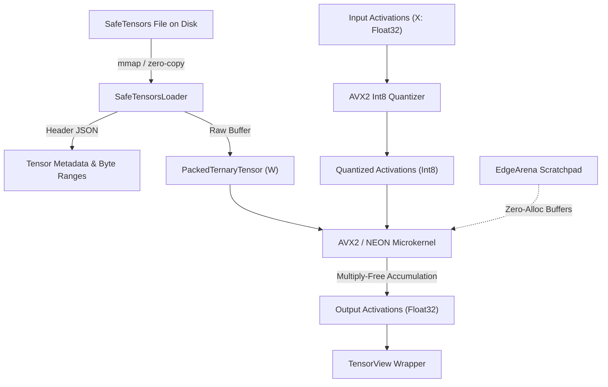

# Kiến Trúc Tầng Tensor & Đại Số Tuyến Tính Tam Phân (Tersun Tensor Architecture Reference)

```text
Document Version:    1.1.0
Architecture State:  Tersun Gate 7.5 (Cryptographically Sealed)
Subsystem:           Packed Ternary Representation, TensorView & Hardware-Accelerated Microkernels
Primary Owners:      Tensor Math & Native Backend Team
```

---

## I. Vai Trò & Trách Nhiệm Hệ Thống Con (File Đó Làm Gì)

Tầng **Tersun Tensor** là nền tảng tính toán đại số ma trận và mảng đa chiều chuyên biệt cho kiến trúc máy tính tam phân cân bằng và mô hình nơ-ron BitNet 1.58-bit. Trách nhiệm cốt lõi bao gồm:
1. **Biểu diễn dữ liệu tam phân đóng gói (Packed Ternary Layout)**: Nén các giá trị trit $\{-1, 0, +1\}$ với mật độ bit tối ưu (2-bit per trit hoặc 5 trits trong 1 byte $3^5 = 243 < 256$), tiết kiệm tới $75\%$ băng thông bộ nhớ so với FP16/FP32.
2. **Trừu tượng hóa Tensor Không Sao Chép (Zero-Copy `TensorView`)**: Cung cấp các thao tác cắt lát (slice), định hình lại (reshape), và chuyển vị (transpose) mà không phát sinh bất kỳ thao tác cấp phát hay sao chép bộ nhớ nào.
3. **Bộ cấp phát vùng nhớ chuyên dụng (`EdgeArena`)**: Quản lý bộ nhớ đệm tính toán cho các thiết bị biên với độ trễ $O(1)$ và cam kết không phân mảnh RAM.
4. **Nạp trọng số mô hình chuẩn (`SafeTensorsFile`)**: Nạp trực tiếp dữ liệu tensor từ định dạng HuggingFace SafeTensors qua memory-map (`mmap`).

---

## II. Nguyên Lý & Cơ Chế Hoạt Động (Như Thế Nào)

### 1. Cơ Chế Đóng Gói Trọng Số Tam Phân (Packed Ternary Encoding)
Với các trọng số $W \in \{-1, 0, +1\}$, Tersun áp dụng cơ chế mã hóa 2-bit bù:
- `0b00`: Giá trị $0$
- `0b01`: Giá trị $+1$
- `0b11`: Giá trị $-1$
- `0b10`: Dự trữ (Invalid / Padding)

### 2. Phép Nhân Ma Trận Không Cần Bộ Nhân (Multiplication-Free GEMM)
Tại vi nhân, phép nhân tích chập ma trận $Y = X \times W^T$ được chuyển đổi hoàn toàn thành phép cộng và trừ có điều kiện:
$$Y_{i, j} = \sum_{k=0}^{K-1} X_{i, k} \cdot W_{j, k} = \sum_{k \mid W_{j, k} = +1} X_{i, k} - \sum_{k \mid W_{j, k} = -1} X_{i, k}$$
Triệt tiêu hoàn toàn sự phụ thuộc vào các khối nhân phần cứng DSP/FPU đắt đỏ, cho phép đạt thông lượng tính toán cực đại trên CPU x86-64 thông qua các lệnh nạp và cộng vector AVX2 `vpaddd` / `vpsubd`.

### 3. Vùng Nhớ Kích Hoạt `EdgeArena`
`EdgeArena` chia không gian bộ nhớ thành các khối liên tục được căn chỉnh 64-byte (Cache-Line Alignment). Mỗi lớp Transformer tái sử dụng cùng một vùng nhớ scratchpad thông qua con trỏ offset tuyến tính, bảo đảm `malloc == 0` tuyệt đối ở hot-path.

---

## III. Cấu Trúc Dữ Liệu & Danh Mục Tệp Nguồn (Cấu Trúc Ra Sao)

### 1. Danh Mục Tệp Nguồn Cốt Lõi
- `Code/include/tensor/tensor.hpp` & `Code/src/tensor/tensor.cpp`: Lớp `Tensor` đa chiều hỗ trợ quản lý bộ nhớ tự chủ và chia sẻ.
- `Code/include/tensor/tensor_shape.hpp`: Cấu trúc hình học tensor `TensorShape` hỗ trợ rank từ 1 đến 6 chiều và tính toán stride tự động.
- `Code/include/tensor/tensor_dtype.hpp`: Hệ thống kiểu dữ liệu tensor (`Float32`, `Int8`, `Int32`, `PackedTernary2Bit`, `PackedTernary5Bit`, `TernaryAlgebraic`).
- `Code/include/tensor/tensor_view.hpp`: Lớp `TensorView` thao tác không sao chép trên con trỏ bộ nhớ đệm thô.
- `Code/include/tensor/packed_ternary_layout.hpp`: Đặc tả bố cục bitmask và chỉ số byte của mảng tam phân nén.
- `Code/include/tensor/safetensors_loader.hpp` & `Code/src/tensor/safetensors_loader.cpp`: Bộ nạp file `.safetensors` không phụ thuộc thư viện ngoài.
- `Code/include/tensor/edge_arena.hpp` & `Code/src/tensor/edge_arena.cpp`: Vùng nhớ tĩnh `EdgeArena` cấp phát cố định cho suy luận biên.

### 2. Danh Mục Vi Nhân Phần Cứng (`kernels/`)
- `Code/include/tensor/kernels/microkernels.hpp`: Giao diện gọi hàm vi nhân SIMD đa nền tảng.
- `Code/src/tensor/kernels/bitnet_avx2.cpp`: Cài đặt vi nhân tối ưu AVX2 FMA 256-bit cho x86-64.
- `Code/src/tensor/kernels/bitnet_neon.cpp`: Cài đặt vi nhân ARM64 NEON cho thiết bị di động/Android.
- `Code/src/tensor/kernels/bitnet_scalar_ladder.cpp`: Bộ vi nhân vô hướng chuẩn tắc (Scalar Fallback & Differential Oracle).

---

## IV. Sơ Đồ Luồng & Hợp Đồng Dữ Liệu (Pipeline Rõ Ràng)



### Hợp Đồng Giao Tiếp Kỹ Thuật
- **Căn chỉnh địa chỉ (Alignment)**: Mọi tensor kích hoạt và trọng số bắt buộc phải được căn chỉnh địa chỉ tối thiểu 32-byte (cho AVX2) hoặc 64-byte (cho AVX-512).
- **Hợp đồng tính đúng đắn vi sai**: Mọi phép toán ma trận trên vi nhân tăng tốc AVX2/NEON phải khớp tuyệt đối từng bit (`memcmp == 0`) hoặc có sai số $|\Delta| < 10^{-6}$ so với vi nhân vô hướng `bitnet_scalar_ladder.cpp`.
