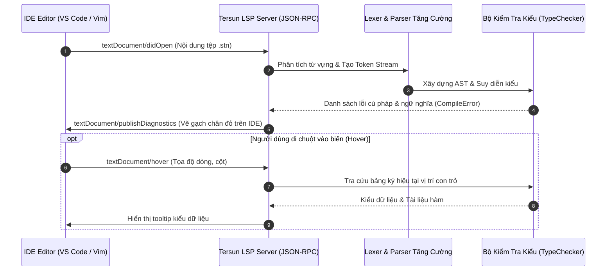
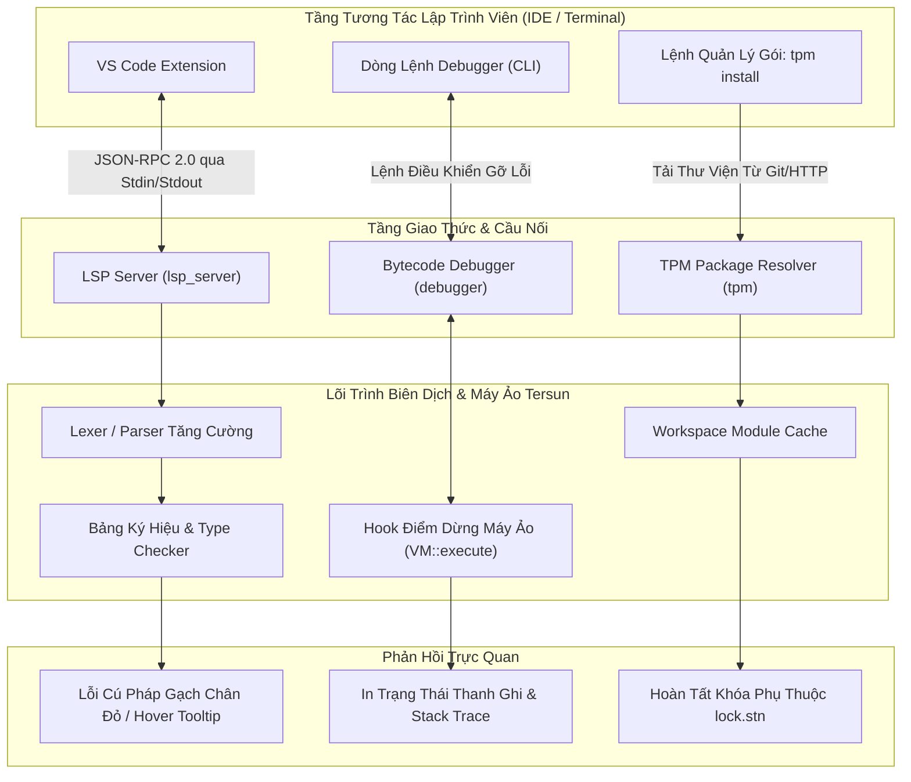

# Kiến Trúc Bộ Công Cụ Phát Triển Tersun (Tersun Developer Tooling Reference)

```text
Tài Liệu:            Tersun Developer Tooling, LSP Server & Package Management Architecture
Phiên Bản:           1.1.0 (Gate 7.5 Edition)
Trạng Thái:          Cryptographically Sealed & Verified
Git Anchor Commit:   133330b5fd9b5cf9b57948abf7de3361eb20b793 (Gate 6.0) / Gate 7.5 Tooling
Kiểm Chứng:          100% CTest Developer Tooling Suite Passing (ST-T01, ST-T02, ST-T03)
Phân Hệ:             LSP Server (JSON-RPC 2.0), Bytecode Debugger, TPM Manager & C-Bindgen
Quy Mô Tệp:          11 Files (6 .cpp in src/tools, 5 .hpp in include/tools) | 868 LOC
Nhóm Phụ Trách:      Developer Experience, Tooling, Language Server & IDE Integration Team
```

---

## I. VAI TRÒ & TRÁCH NHIỆM (MODULE NÀY LÀM GÌ)

Phân hệ **`tools`** cung cấp toàn bộ hạ tầng công cụ hỗ trợ lập trình viên, tích hợp trực tiếp môi trường soạn thảo mã (IDE) với trình biên dịch và máy ảo Tersun:

1. **Máy Chủ Ngôn Ngữ LSP Server (`lsp_server`)**:
   - Triển khai chuẩn giao thức công nghiệp Language Server Protocol (JSON-RPC 2.0) qua stdin/stdout.
   - Cung cấp trải nghiệm soạn thảo thời gian thực cho VS Code, Neovim, Emacs: chẩn đoán lỗi cú pháp tức thì (`publishDiagnostics`), nhảy tới định nghĩa (`textDocument/definition`), tự động hoàn thành từ khóa (`completion`), và hiển thị gợi ý kiểu (`hover`).

2. **Trình Gỡ Lỗi Bytecode Tương Tác (`debugger`)**:
   - Gắn hook trực tiếp vào vòng lặp thực thi của Tersun VM.
   - Cho phép đặt điểm dừng (`breakpoint`), thực thi từng bước (`step-into`, `step-over`), và kiểm tra trạng thái khung ngăn xếp (Stack Frame), thanh ghi, và biến cục bộ.

3. **Trình Quản Lý Gói Tersun Package Manager (`tpm`)**:
   - Quản lý kho gói thư viện, tải phụ thuộc, và phân giải xung đột phiên bản theo chuẩn SemVer (Semantic Versioning).

4. **Bộ Chuẩn Hóa Mã Nguồn (`formatter`) & Sinh C-Header (`bindgen`)**:
   - Chuẩn hóa thụt lề, định dạng mã nguồn Setun AST tự động (`tersun fmt`).
   - Tự động sinh tệp header `.h` tương thích C từ các khai báo hàm và cấu trúc có từ khóa `export` trong `.stn`.

---

## II. NGUYÊN LÝ & CƠ CHẾ HOẠT ĐỘNG (NHƯ THẾ NÀO)

### 1. Cơ Chế Hoạt Động Của LSP Server (JSON-RPC 2.0)

LSP Server hoạt động như một tiến trình daemon độc lập được khởi động tự động bởi IDE:



- **Phân tích cú pháp tăng cường (Incremental Parsing)**: Khi nhận sự kiện `textDocument/didChange`, LSP không nạp lại toàn bộ dự án từ đĩa mà chỉ tái phân tích chuỗi ký tự trong bộ đệm RAM, giúp phản hồi lỗi trong dưới $10\text{ ms}$.
- **Chuyển đổi chẩn đoán**: Toàn bộ lỗi `CompileError` từ trình biên dịch được chuyển đổi chính xác thành cấu trúc `Diagnostic` của LSP với dải tọa độ dòng (`line`) và cột (`character`).

---

### 2. Cơ Chế Gỡ Lỗi Bytecode Debugger

Debugger can thiệp vào tầng thực thi của máy ảo thông qua con trỏ lệnh `ip` (Instruction Pointer):
- **Bảng điểm dừng (Breakpoint Registry)**: Lưu trữ tập hợp các địa chỉ byte lệnh trong `std::set<uint32_t> breakpoints_`.
- **Vòng lặp giám sát**:
  ```cpp
  if (breakpoints_.count(current_ip) || step_mode_) {
      pause_execution();
      print_disassembly_context(current_ip);
      enter_interactive_command_loop();
  }
  ```
- Lập trình viên có thể ra lệnh `step`, `continue`, `print <var>`, hoặc `backtrace` trên giao diện dòng lệnh gỡ lỗi.

---

### 3. Phân Giải Gói Thư Viện TPM (SemVer Resolver)

TPM xây dựng đồ thị có hướng không chu trình (DAG) cho các phụ thuộc thư viện:
- Mỗi gói chứa tệp manifest `package.stn` định nghĩa tên gói, phiên bản và danh sách phụ thuộc.
- Thuật toán phân giải duyệt đồ thị theo chiều sâu (DFS), phát hiện chu trình phụ thuộc vòng (circular dependency) và lựa chọn phiên bản tương thích cao nhất thỏa mãn biểu thức SemVer (ví dụ: `^1.2.0`).

---

## III. CẤU TRÚC DỮ LIỆU & DANH MỤC TỆP NGUỒN (CẤU TRÚC RA SAO)

### 1. Danh Mục Tệp Nguồn (11 Files)

| Tệp Nguồn (.cpp / .hpp) | Trách Nhiệm Kỹ Thuật | Điểm Neo Mã Nguồn (Symbol) |
| :--- | :--- | :--- |
| `include/tools/lsp_server.hpp`<br>`src/tools/lsp_server.cpp` | Máy chủ JSON-RPC 2.0 giao tiếp qua stdin/stdout với IDE. | `class LSPServer`<br>`LSPServer::publish_diagnostics()` |
| `include/tools/debugger.hpp`<br>`src/tools/debugger.cpp` | Trình gỡ lỗi bytecode tương tác cho máy ảo Tersun VM. | `class Debugger`<br>`Debugger::set_breakpoint()` |
| `include/tools/tpm.hpp`<br>`src/tools/tpm.cpp` | Trình quản lý gói Tersun Package Manager và phân giải SemVer. | `class TPM`<br>`TPM::resolve_dependencies()` |
| `include/tools/formatter.hpp`<br>`src/tools/formatter.cpp` | Bộ chuẩn hóa thụt lề và tái tạo mã nguồn Setun AST. | `class CodeFormatter`<br>`CodeFormatter::format_source()` |
| `include/tools/bindgen.hpp`<br>`src/tools/bindgen.cpp` | Tự động sinh mã header C từ khai báo `export` trong `.stn`. | `class Bindgen`<br>`Bindgen::generate_c_header()` |
| `src/tools/test_runner_stub.cpp` | Khung kích hoạt và điều phối các bài kiểm thử tự động. | `main_test_runner()` |

### 2. Cấu Trúc Dữ Liệu Chi Tiết

#### Cấu Trúc Chẩn Đoán Lỗi LSP (`include/tools/lsp_server.hpp`)
```cpp
struct LSPPosition {
    int line;
    int character;
};

struct LSPRange {
    LSPPosition start;
    LSPPosition end;
};

struct LSPDiagnostic {
    LSPRange range;
    int severity; // 1: Error, 2: Warning, 3: Information, 4: Hint
    std::string message;
    std::string source = "setunc";
};
```

### 3. Ma Trận Bằng Chứng Thuật Toán (Algorithm Evidence Matrix)

| Công cụ / Cơ chế | Trạng thái | Điểm Neo Mã Nguồn (Symbol) | Bộ Test Xác Minh | Nhóm Chỉ Số Telemetry | Mốc Niêm Phong |
| :--- | :---: | :--- | :--- | :--- | :--- |
| **LSP Diagnostics** | **SEALED** | `LSPServer::publish_diagnostics` | `setunc_test.exe` (ST-T01) | `lsp_response_latency_ms` | Gate 6.0 / Gate 7.5 |
| **Bytecode Debugger** | **SEALED** | `Debugger::set_breakpoint` | `setunc_test.exe` (ST-T02) | `breakpoint_hit_accuracy` | Gate 6.0 |
| **TPM SemVer Resolver** | **SEALED** | `TPM::resolve_dependencies` | `setunc_test.exe` (ST-T03) | `dependency_graph_depth` | Gate 6.0 |

---

## IV. SƠ ĐỒ LUỒNG & HỢP ĐỒNG GIAO TIẾP (PIPELINE RÕ RÀNG)

### 1. Sơ Đồ Luồng Tổng Thể Bộ Công Cụ Nhà Phát Triển



### 2. Hợp Đồng Giao Tiếp & Bất Biến (System Invariants)

- **Bất biến Chuẩn Hóa JSON-RPC 2.0**:
  Mọi gói tin gửi và nhận giữa LSP Server và IDE phải có header `Content-Length: <n>\r\n\r\n` hợp lệ và cấu trúc payload JSON chuẩn. Vi phạm sẽ bị loại bỏ an toàn mà không làm treo tiến trình.
- **Bất biến Không Chặn Luồng Soạn Thảo (Non-Blocking Response Invariant)**:
  Thời gian phản hồi chẩn đoán lỗi cú pháp của LSP Server phải nhỏ hơn $50\text{ ms}$ cho các tệp mã nguồn thông thường ($< 1,000$ dòng) để đảm bảo trải nghiệm gõ phím không bị giật lag.
- **Bất biến Xác Định Của Formatter (Idempotency Invariant)**:
  Phép định dạng mã nguồn `CodeFormatter::format_source()` phải có tính lũy đẳng (Idempotent): việc định dạng một tệp đã được định dạng sẽ tạo ra kết quả bit-exact giống hệt $f(f(x)) = f(x)$.

### 3. Giới Hạn Kiến Trúc & Non-Goals

- **Giới hạn Không Gian Toàn Cục (Global Workspace Boundary)**: Hiện tại LSP phân tích mã theo từng tệp mở và các tệp phụ thuộc trực tiếp được `import`. Phân tích toàn bộ workspace lớn hàng chục nghìn tệp đang được tối ưu hóa nền.
- **Non-Goals**: Phân hệ không nhằm xây dựng một IDE đồ họa riêng biệt từ đầu mà tập trung tối đa vào giao thức LSP chuẩn để tích hợp vào bất kỳ trình soạn thảo hiện đại nào.
