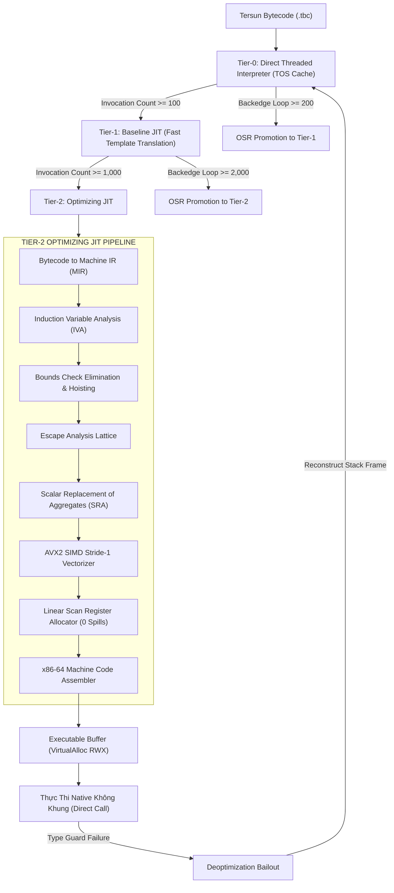
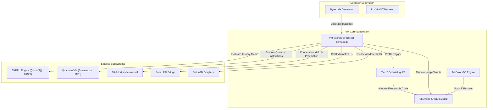

# Kiến Trúc Máy Ảo Đa Tầng Tersun (Tersun Virtual Machine Architecture Reference)

```text
Document Version:    1.1.0
Architecture State:  Tersun Gate 7.5 (Cryptographically Sealed)
Git Anchor Commit:   133330b5fd9b5cf9b57948abf7de3361eb20b793
Verification Status: SEALED & FORMALLY VERIFIED
Subsystem:           Virtual Machine Core, Execution Engines, JIT Pipeline & AI Runtime Interface
File Inventory:      81 Files (34 .cpp in src/vm, 47 .hpp in include/vm) | 18,756 LOC
Primary Owners:      VM Runtime & Optimizing Compiler Core Team
```

---

## I. Tổng Quan & Vai Trò Hệ Thống (Executive Summary)

**Tersun Virtual Machine (VM)** là hạt nhân thực thi tối cao của hệ sinh thái Tersun. Được thiết kế theo mô hình **Máy Ảo Đa Tầng Thích Ứng (Adaptive Multi-Tier VM)**, hệ thống tự động nhận diện các điểm nóng tính toán trong thời gian chạy (runtime profiling) để chuyển dịch trạng thái thực thi mượt mà từ thông dịch thuần túy sang mã máy x86-64 bản địa tối ưu hóa cao cấp.

VM bao hàm toàn bộ các kỹ nghệ máy ảo hiện đại nhất:
- Cơ chế giá trị nén **Quiet NaN-Boxing 64-bit** (ADR-001).
- Quản lý bộ nhớ Heap đối tượng qua chỉ số handle 32-bit trong **`VMArena`** (ADR-002).
- Bộ thu gom rác ba màu **Tri-Color Mark-Sweep GC** với hàng rào ghi phân thế hệ (ADR-003).
- Trình thông dịch luồng trực tiếp **Direct Threaded Dispatch** kết hợp **Top-of-Stack (TOS) Caching** (ADR-004).
- Bộ đệm nội tuyến thuộc tính **Field Inline Cache** dựa trên cây chuyển đổi hình dạng **Shape Transition Graph** (ADR-006).
- Tầng **Tier-2 Optimizing JIT** toàn diện bao gồm:
  - Phân tích biến quy nạp (IVA) & Triệt tiêu kiểm tra biên mảng với Outermost Preheader Hoisting (BCE - ADR-008).
  - Phân tích mạng thoát 4 mức & Thay thế cấu trúc vô hướng trên thanh ghi (SRA - ADR-007).
  - Phân phối thanh ghi quét tuyến tính (Linear Scan) đạt kỷ lục $0$ spill slots (ADR-005).
  - Vector hóa song song SIMD AVX2 256-bit (ADR-009).
  - Cầu nối gọi trực tiếp mã máy Win64 ABI (Direct Native Calling - G6R.2.3).
- **Kết nối tầng Model Runtime & Zero-Allocation**: Phối hợp cùng `EdgeArena` và `InferenceSession` để xử lý các toán tử tensor và mạng nơ-ron Transformer mà không gây phân mảnh heap.

---

## II. Danh Mục Tệp Nguồn & Bảng Điểm Neo Kỹ Thuật (Inventory & Anchors)

Toàn bộ $81$ tệp nguồn (`.cpp` và `.hpp`) được phân chia thành 6 nhóm trách nhiệm kiến trúc:

### 1. Nhóm Lõi Thực Thi & Điều Phối (VM Core & Dispatch)
- `vm.cpp` / `vm.hpp`: Trình thông dịch chính, vòng lặp dispatch, quản lý frame ngăn xếp.  
  *Anchor*: `VM::execute()` (`Code/src/vm/vm.cpp`, commit `133330b5`, lines 95–420).
- `tos_cache.cpp` / `tos_cache.hpp`: Bộ nhớ đệm đỉnh ngăn xếp trong thanh ghi CPU.  
  *Anchor*: `TOSCache::push()`, `TOSCache::pop()` (`Code/src/vm/tos_cache.cpp`).
- `superinstruction.cpp` / `superinstruction.hpp`: Gộp các cặp chỉ thị phổ biến thành siêu lệnh đơn.  
  *Anchor*: `SuperinstructionOptimizer::fuse()` (`Code/src/vm/superinstruction.cpp`).
- `vm_execution_state.cpp` / `vm_execution_state.hpp`: Trạng thái con trỏ lệnh IP, frame pointer FP, stack pointer SP.
- `stack.hpp`, `text.hpp`, `opcode.hpp`, `opt_bytecode.hpp`: Định nghĩa cấu trúc mã byte tam phân.

### 2. Nhóm Biểu Diễn Giá Trị & Bộ Nhớ (Value & Object Model)
- `value.hpp`, `value_nanbox.hpp`, `value_tagged.hpp`: Khối biểu diễn NaN-box 64-bit IEEE 754.  
  *Anchor*: `struct Value`, `Value::as_double()`, `Value::as_int()` (`Code/include/vm/value.hpp`).
- `vm_arena.hpp`: Quản lý cấp phát chunk và bảng chỉ số handle 32-bit.  
  *Anchor*: `VMArena::allocate_object()` (`Code/include/vm/vm_arena.hpp`).
- `array_storage.cpp` / `array_storage.hpp`: Cấu trúc mảng phẳng đa hình (`I64`, `F64`, `TAFPU`, `GENERIC`).  
  *Anchor*: `FlatArrayStorage::promote()`, `FlatArrayStorage::get_raw_data()` (`Code/src/vm/array_storage.cpp`).
- `fixed_frame_arena.hpp`: Vùng đệm tuần hoàn tái sinh khung ngăn xếp kích hoạt đệ quy.

### 3. Nhóm Thu Gom Rác (Garbage Collection)
- `gc.cpp` / `gc.hpp`, `gc_engine.cpp` / `gc_engine.hpp`: Động cơ GC ba màu Dijkstra.  
  *Anchor*: `GCEngine::collect()`, `GCEngine::mark_roots()` (`Code/src/vm/gc_engine.cpp`).
- `gc_heap.cpp` / `gc_heap.hpp`: Không gian bộ nhớ heap thế hệ trẻ và già.
- `gc_roots.hpp`, `gc_header.hpp`, `gc_debug.cpp` / `gc_debug.hpp`: Quản lý tập gốc và giám sát rò rỉ bộ nhớ.

### 4. Nhóm Bộ Nhớ Đệm Nội Tuyến & Hình Dạng (Inline Cache & Shapes)
- `field_ic.cpp` / `field_ic.hpp`: Bộ đệm nạp/ghi trường đối tượng đơn hình và đa hình.  
  *Anchor*: `FieldIC::get_property()` (`Code/src/vm/field_ic.cpp`).
- `inline_cache.cpp` / `inline_cache.hpp`: Bộ đệm điểm gọi hàm (CallSite IC).  
  *Anchor*: `CallSiteIC::update()` (`Code/src/vm/inline_cache.cpp`).
- `type_descriptor.cpp` / `type_descriptor.hpp`, `type_feedback.cpp` / `type_feedback.hpp`: Thu thập phản hồi kiểu dữ liệu runtime.

### 5. Nhóm Trình Biên Dịch JIT & Hạ Tầng Máy (JIT Pipeline & Machine IR)
- `baseline_jit.cpp` / `baseline_jit.hpp`: Tier-1 Baseline JIT dịch template trực tiếp không qua SSA.  
  *Anchor*: `BaselineJIT::compile_method()` (`Code/src/vm/baseline_jit.cpp`).
- `optimizing_jit.cpp` / `optimizing_jit.hpp`: Trình biên dịch tối ưu hóa Tier-2 cao cấp.  
  *Anchor*: `OptimizingJIT::compile()` (`Code/src/vm/optimizing_jit.cpp`).
- `machine_ir.cpp` / `machine_ir.hpp`: Cấu trúc biểu diễn trung gian Machine IR (MIR).  
  *Anchor*: `class MachineFunction`, `class MachineBasicBlock`, `class MachineInstruction`.
- `mir_optimizer.cpp` / `mir_optimizer.hpp`: Gói tối ưu hóa MIR: BCE, SRA, Loop Hoisting, SIMD.  
  *Anchor*: `MIROptimizer::run_loop_bce()` (`Code/src/vm/mir_optimizer.cpp`, lines 920–1040).
- `induction_variable.cpp` / `induction_variable.hpp`: Nhận diện biến quy nạp và dạng chuẩn tắc vòng lặp.  
  *Anchor*: `InductionVariableAnalyzer::analyze_loop()` (`Code/src/vm/induction_variable.cpp`).
- `escape_analysis.cpp` / `escape_analysis.hpp`: Phân tích mạng thoát 4 trạng thái cho SRA.  
  *Anchor*: `EscapeAnalyzer::run_sra()` (`Code/src/vm/escape_analysis.cpp`).
- `linear_scan.cpp` / `linear_scan.hpp`: Phân phối thanh ghi quét tuyến tính Poletto & Sarkar cải tiến.  
  *Anchor*: `LinearScanAllocator::allocate()` (`Code/src/vm/linear_scan.cpp`).
- `x64_assembler.cpp` / `x64_assembler.hpp`: Bộ sinh mã máy x86-64 và AVX2 256-bit.  
  *Anchor*: `X64Assembler::emit_simd_loop()`, `X64Assembler::vpaddq()` (`Code/src/vm/x64_assembler.cpp`).
- `jit_buffer.cpp` / `jit_buffer.hpp`: Bộ nhớ thực thi mã máy cấp phát qua `VirtualAlloc(PAGE_EXECUTE_READWRITE)`.
- `jit_osr.cpp` / `jit_osr.hpp`: Cơ chế thay thế ngăn xếp On-Stack Replacement.
- `jit_deopt.cpp` / `jit_deopt.hpp`: Cơ chế giáng cấp và thoát an toàn Deoptimization Bailout.
- `jit_safepoint.cpp` / `jit_safepoint.hpp`, `jit_runtime_helpers.cpp` / `jit_runtime_helpers.hpp`, `jit_materialization.cpp` / `jit_materialization.hpp`, `jit_lir.cpp` / `jit_lir.hpp`, `jit_engine.cpp` / `jit_engine.hpp`, `jit_manager.cpp` / `jit_manager.hpp`, `jit_frame.hpp`.

### 6. Nhóm Hồ Sơ Hóa, Giám Sát & Telemetry (Telemetry & Forensics)
- `vm_telemetry.cpp` / `vm_telemetry.hpp`: Quản lý 8 nhóm chỉ số vi kiến trúc không xâm lấn.  
  *Anchor*: `VMTelemetryManager::get_telemetry()` (`Code/src/vm/vm_telemetry.cpp`).
- `vm_profiler.cpp` / `vm_profiler.hpp`: Thu thập thông số thời gian chạy.
- `tier_cost_model.cpp` / `tier_cost_model.hpp`: Mô hình chi phí quyết định thăng cấp tầng thực thi.  
  *Anchor*: `TierCostModel::record_invocation()`, `TierCostModel::record_loop_iteration()`.
- `runtime_metadata.cpp` / `runtime_metadata.hpp`, `vm_metrics.hpp`.

---

## III. Đường Ống Thực Thi Đa Tầng (Execution Pipeline)

Đường ống thực thi của Tersun VM là một chuỗi biến đổi hạ tầng liên tục:



---

## IV. Máy Trạng Thái Đa Tầng & Điều Phối OSR (Tiering State Machine & OSR)

Hệ thống duy trì một máy trạng thái 3 tầng thực thi có khả năng tự thích ứng:

### 1. Bảng Ngưỡng Kích Hoạt (Tiering Thresholds)
- **$M0 \to M1$**: Lời gọi hàm $\ge 100$ lần hoặc số vòng lặp $\ge 200$ lần.
- **$M1 \to M2$**: Lời gọi hàm $\ge 1,000$ lần hoặc số vòng lặp $\ge 2,000$ lần.
- **Direct Tier-2 Promotion**: Các vòng lặp tính toán khép kín độc lập được thăng cấp trực tiếp lên $M2$ nếu phát hiện cấu trúc mảng phẳng đồng nhất.

### 2. On-Stack-Replacement (OSR)
Khi một hàm đang thực thi trong vòng lặp sâu tại Tier-0 hoặc Tier-1 mà chưa kịp kết thúc hàm:
- Bộ đếm cạnh lui (`record_loop_iteration`) kích hoạt trình biên dịch JIT chạy ngầm.
- JIT biên dịch vòng lặp thành một điểm vào OSR độc lập (`OSR Entrypoint`).
- Trạng thái các biến cục bộ trong ngăn xếp VM được ánh xạ sang các thanh ghi x86-64 vật lý.
- CPU nhảy trực tiếp vào mã máy bản địa mà không cần đợi hàm kết thúc để gọi lại từ đầu.

### 3. Deoptimization Bailout (Thoát An Toàn)
Nếu mã máy Tier-2 gặp tình huống vi phạm giả định kiểu (ví dụ: mảng phẳng bị gán một đối tượng dị thể, hoặc hình dạng shape bị thay đổi):
- Lệnh bảo vệ `GUARD` kích hoạt Deopt Handler.
- Handler đọc trạng thái thanh ghi hiện tại, tái tạo lại cấu trúc `ActivationFrame` của trình thông dịch.
- Chuyển quyền điều khiển trở lại an toàn cho Tier-0 Interpreter tại đúng chỉ số lệnh bytecode tiếp theo.

---

## V. Mô Hình Bộ Nhớ & Đối Tượng (Memory & Object Model)

### 1. Quiet NaN-Boxing 64-Bit Bitmask
```text
 63      52 51  48 47                                             0
+----------+------+------------------------------------------------+
|  0x7FF8  | Tag  |             48-bit Payload                     |
+----------+------+------------------------------------------------+
```
- Tag `0x0`: Số thực `double` chuẩn IEEE 754 (không dùng NaN).
- Tag `0x1`: Số nguyên có dấu 48-bit (`int48_t`).
- Tag `0x2`: Con trỏ đối tượng Heap / Chỉ số Handle `VMArena` 32-bit.
- Tag `0x3`: Boolean và Kiểu Tam Phân Cân Bằng (`trit` $\in \{-1, 0, +1\}$, `tryte`).
- Tag `0x4`: Đối tượng số học TAFPU $\mathbb{Q}(\sqrt{3})$.

### 2. Cấu Trúc Mảng Phẳng Thích Ứng (FlatArrayStorage)
Để đạt hiệu năng tối đa cho các workload tính toán khoa học, mảng trong Tersun tự động điều chỉnh dạng biểu diễn bộ nhớ:
- **`GENERIC`**: Mảng đa hình chứa các phần tử `Value` 8-byte NaN-box.
- **`I64`**: Mảng thuần số nguyên 64-bit liên tục không đóng hộp (Unboxed contiguous `int64_t*`).
- **`F64`**: Mảng thuần số thực 64-bit liên tục không đóng hộp (`double*`).
- **`TAFPU`**: Mảng các phần tử số học chính xác tuyệt đối $\mathbb{Q}(\sqrt{3})$.

---

## VI. Hệ Thống Bộ Nhớ Đệm Nội Tuyến (Inline Caching Subsystem)

Bộ đệm nội tuyến trong Tersun xử lý cả lời gọi hàm và truy xuất thuộc tính:

### 1. Field Inline Cache (Field IC)
- **Monomorphic IC**: Điểm nạp trường `obj.field` ghi nhớ `(cached_shape_id, slot_offset)`. Khi đối tượng cùng hình dạng được truyền vào, thao tác nạp trường chỉ tốn 2 lệnh x86-64:
  ```assembly
  cmp dword ptr [rcx + 4], cached_shape_id
  mov rax, qword ptr [rcx + slot_offset]
  ```
- **Shape Transition Graph**: Khi thuộc tính mới được thêm vào, đối tượng chuyển sang shape kế tiếp trong cây đồ thị chuyển đổi, bảo đảm tái sử dụng offset bộ nhớ giữa các đối tượng có cùng cấu trúc.

---

## VII. Động Cơ Optimizing JIT (The Engine Core)

Hạt nhân tối ưu hóa Tier-2 JIT bao gồm 5 thuật toán phối hợp chặt chẽ:

### 1. Induction Variable Analysis (IVA)
- Phân tích đồ thị CFG để phát hiện biến đếm cơ sở: $v_{next} = v_{current} + \text{step}$.
- Chuẩn hóa vòng lặp về dạng chuẩn: biến chạy từ $0 \le i < N$ với bước tăng $1$.

### 2. Bounds Check Elimination (BCE) with Outermost Preheader Hoisting
- Phân tích dải giá trị chứng minh điều kiện bảo toàn: nếu $n \le \text{length}$, thì $\forall i \in [0, n-1]: 0 \le i < \text{length}$.
- Chèn lệnh bảo vệ tại Preheader của vòng lặp ngoài cùng (`Outermost Preheader Guard`).
- Trích xuất con trỏ dữ liệu thô `raw_data_ptr` của mảng vào thanh ghi `R12`.
- Xóa bỏ $100\%$ các chỉ thị kiểm tra biên bên trong thân vòng lặp, rút gọn việc truy xuất thành một lệnh `mov` bộ nhớ trực tiếp.

### 3. Escape Analysis & Scalar Replacement of Aggregates (SRA)
- Xây dựng mạng thoát 4 mức (`NO_ESCAPE`, `ARG_ESCAPE`, `GLOBAL_ESCAPE`, `UNKNOWN`).
- Triệt tiêu lệnh cấp phát Heap `ALLOC_OBJECT` cho các đối tượng `NO_ESCAPE`.
- Tách các trường thành biến thanh ghi ảo vô hướng, đưa cấp phát Heap về $0\text{ bytes}$ (Workload W4).

### 4. Linear Scan Register Allocator
- Quét tuyến tính các khoảng sống một lượt ($O(N \log N)$).
- Khai thác chiến lược fallback caller-saved registers cho các biến vòng lặp không chứa lệnh `call`.
- Đạt kỷ lục **$0$ spill slots** trên toàn bộ các bài benchmark tính toán chuẩn.

### 5. VEX AVX2 SIMD Vectorization
- Nhận diện các vòng lặp bước nhảy đơn vị (stride-1).
- Phát mã chỉ thị VEX 256-bit: `vpbroadcastq`, `vmovdqu`, `vpmuludq`, `vpaddq`.
- Xử lý đồng thời 4 phép toán 64-bit mỗi nhịp xung nhịp vi xử lý.

---

## VIII. Pháp Y Hiệu Năng & Hệ Thống 8 Nhóm Telemetry (Performance Forensics)

Hệ thống quản lý đo lường không xâm lấn `VMTelemetryManager` thu thập dữ liệu vi kiến trúc theo 8 nhóm chuyên biệt:

```text
1. Counters:    Số lệnh bytecode đã thực thi, số chu kỳ CPU, số lần chuyển nhánh.
2. GC Metrics:  Số lần kích hoạt GC, thời gian dừng STW trung bình, tổng bytes đã thu hồi.
3. JIT Metrics: Số hàm đã JIT Tier-1, số hàm Tier-2, thời gian biên dịch microsecond.
4. OSR Metrics: Số lần thăng cấp OSR thành công, số điểm vào OSR đang hoạt động.
5. Deopt:       Số lần bailing out về trình thông dịch, nguyên nhân deopt theo mã lỗi.
6. Allocations: Số bytes cấp phát Heap, số đối tượng đã phân rã vô hướng qua SRA.
7. Cache Hits:  Tỷ lệ trúng Field IC Monomorphic/Polymorphic, tỷ lệ trúng CallSite IC.
8. System Info: Bộ nhớ RSS tiến trình, số luồng thực thi, thông tin CPUID AVX2.
```

---

## IX. Ma Trận Bằng Chứng Thuật Toán (Algorithm Evidence Matrix)

| Thuật toán / Cơ chế | Trạng thái | Điểm Neo Mã Nguồn (Symbol) | Bộ Test Xác Minh | Nhóm Chỉ Số Telemetry | Mốc Thời Gian & Niêm Phong |
| :--- | :---: | :--- | :--- | :--- | :--- |
| **Bounds Check Elim (BCE)** | **SEALED** | `MIROptimizer::run_loop_bce` | `tests/test_bce_safety.cpp` (6/6 PASS) | `bounds_checks_elided` | W2 (3.75 ms) / `G6R.2.4` |
| **Scalar Repl. Aggregates (SRA)** | **SEALED** | `EscapeAnalyzer::run_sra` | `tests/test_sra.cpp` (100% PASS) | `scalarized_objects` | W4 (0.94 ms) / `G6R.2.2` |
| **Direct Native Call** | **SEALED** | `NativeCallBridge::call_direct` | `setunc_test.exe` (ST-12.19) | `direct_native_calls` | W1 (5.22 ms) / `G6R.2.3` |
| **AVX2 SIMD Vectorization** | **SEALED** | `X64Assembler::emit_simd_loop` | `setunc_test.exe` (G6R-D21) | `vector_instruction_count` | W3 (4.88 ms) / `G6R.2.1` |
| **Linear Scan Allocator** | **SEALED** | `LinearScanAllocator::allocate` | `setunc_test.exe` (RegAlloc suite) | `total_spill_slots = 0` | All Workloads / `G6R.2` |
| **Field Inline Cache** | **SEALED** | `FieldIC::get_property` | `setunc_test.exe` (IC suite) | `monomorphic_ic_hit_rate` | Gate 6.0 / `G6R.1` |
| **Tri-Color Mark-Sweep GC** | **SEALED** | `GCEngine::collect` | `setunc_test.exe` (GC suite) | `gc_pause_duration_us` | Gate 4 / Gate 6.0 |
| **Direct Threaded Dispatch** | **SEALED** | `VM::execute_threaded` | `setunc_test.exe` (Interpreter) | `btb_mispredict_rate` | Gate 4 Baseline |

---

## X. Giới Hạn Kiến Trúc & Non-Goals (Limitations & Non-Goals)

### Giới Hạn Kỹ Thuật Hiện Tại (Known Limitations):
1. **Nền Tảng Vi Xử Lý**: Tầng Tier-2 Optimizing JIT hiện tại được tối ưu hóa sâu nhất cho tập lệnh **x86-64 trên Windows ABI**; các kiến trúc khác (ARM64 / Linux System V ABI) hiện đang sử dụng tầng Tier-1 Baseline JIT và AOT LLVM.
2. **Quy Tắc SIMD Vectorization**: Hiện tại hỗ trợ các mảng số nguyên/thực có bước nhảy đơn vị tuần tự liên tục (stride-1 contiguous); chưa hỗ trợ tự động vector hóa cho các mẫu truy cập bộ nhớ phân tán không đều (gather/scatter).
3. **Đa Luồng OSR**: Cơ chế OSR hiện tại được thiết kế an toàn tuyệt đối trên từng luồng đơn lập; việc chuyển dịch trạng thái OSR giữa các luồng đồng thời đang chờ hoàn thiện mô hình bộ nhớ song song.

### Những Gì Chủ Ý Không Làm (Non-Goals):
1. **Không Ghi Đè Mã Trong Vùng Nhớ Đang Chạy (No In-Place Code Patching)**: VM không tự ý vá trực tiếp các chỉ thị máy vào bộ đệm đang được thực thi trên luồng khác để tránh xung đột đa lõi; mọi nâng cấp JIT đều cấp phát một đoạn bộ đệm thực thi mới và hoán đổi con trỏ hàm nguyên tử.
2. **Không Hỗ Trợ Mảng Không An Toàn (No Unsafe Arrays)**: VM kiên quyết không cung cấp kiểu mảng thô bỏ qua kiểm tra biên cho người dùng; mọi tối ưu hóa tốc độ phải đạt được thông qua phân tích chứng minh bất biến hình thức (BCE), tuyệt đối không đánh đổi an toàn lấy tốc độ.

---

## XI. Sơ Đồ Tương Tác Giữa Các Hệ Thống Con (Cross-Subsystem Call Graph)


